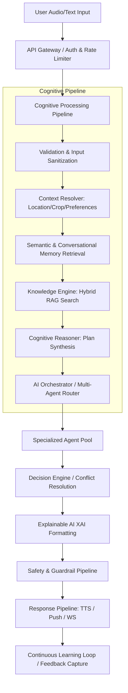
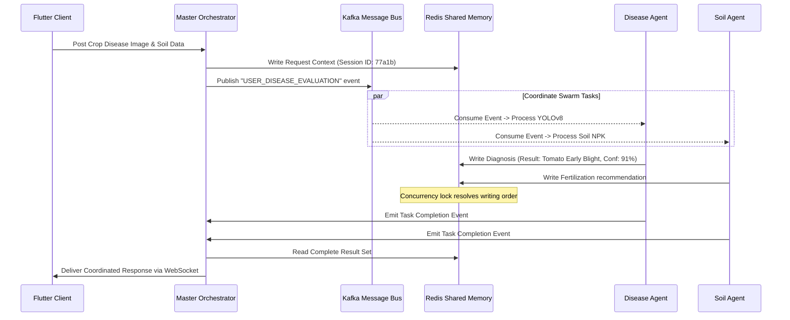
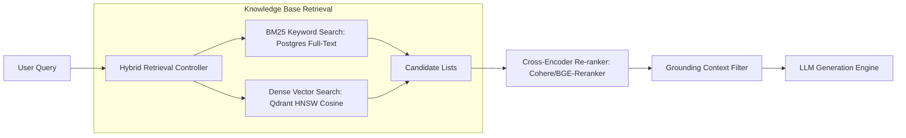
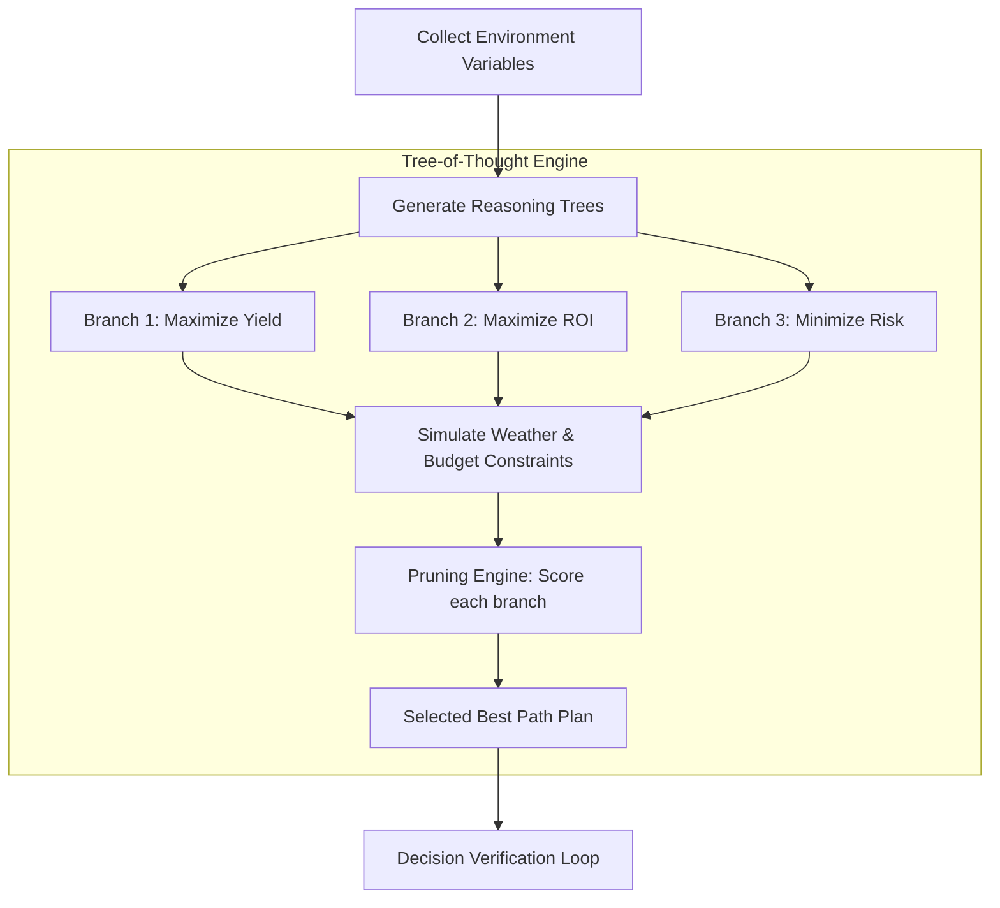
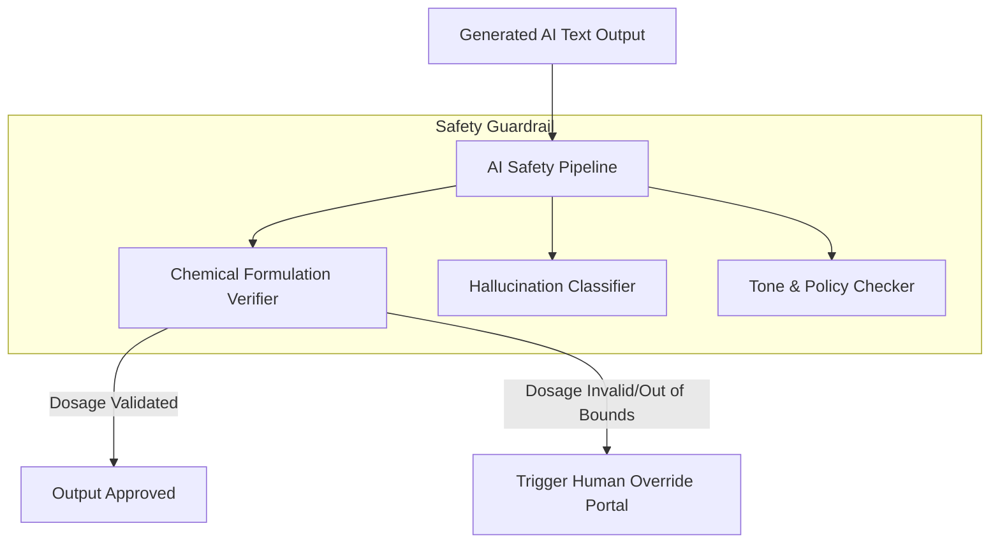
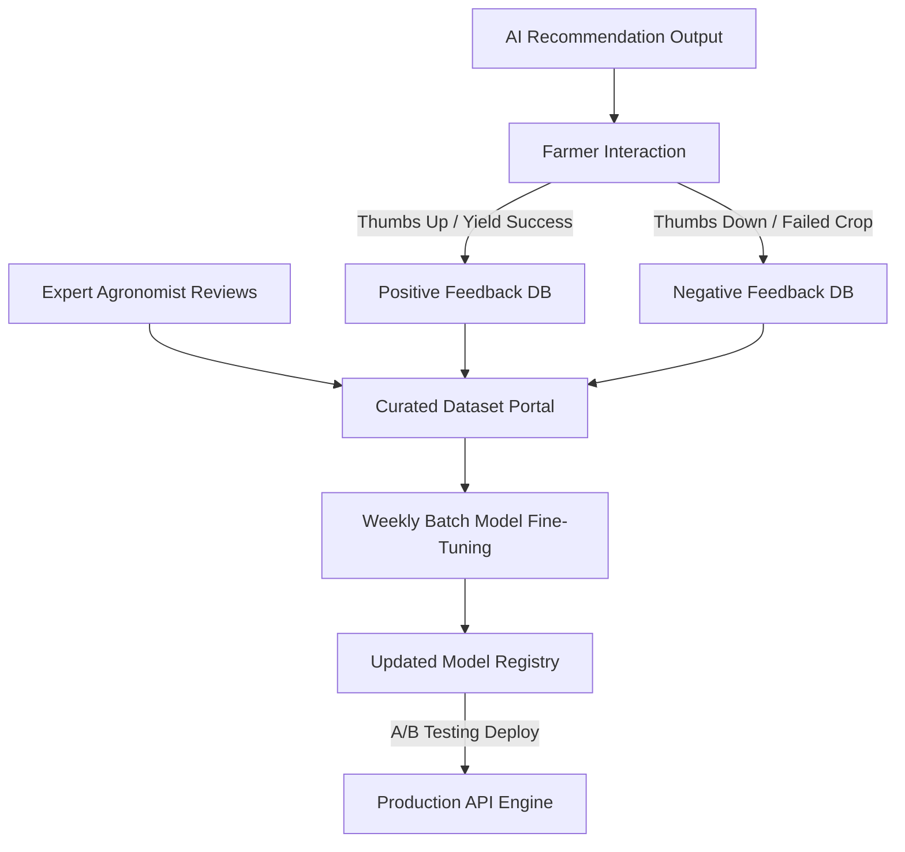
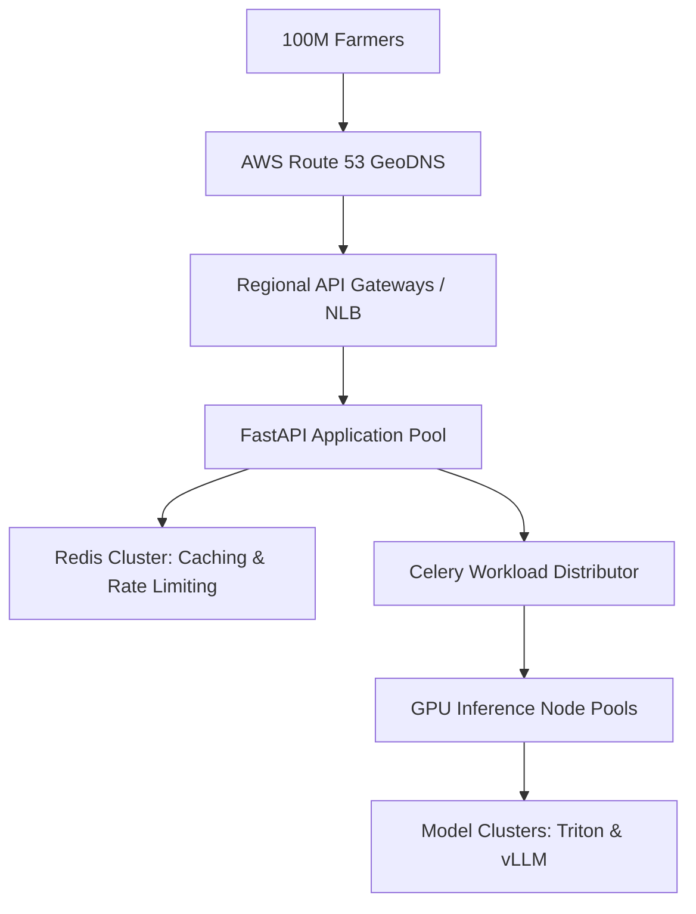
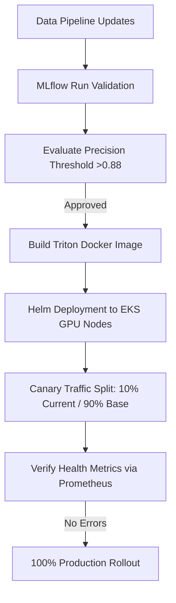
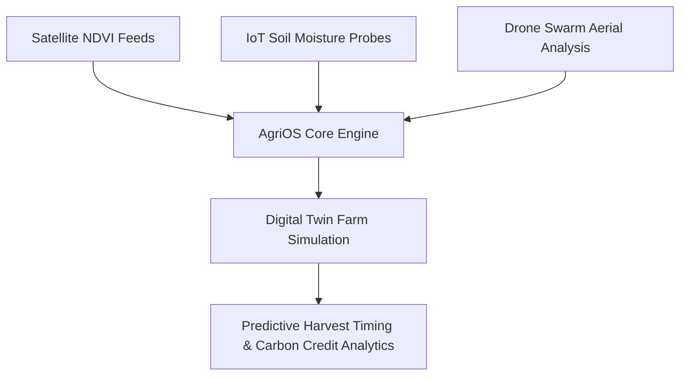

# CONFIDENTIAL ENTERPRISE ARCHITECTURE SPECIFICATION
## SYSTEM: Kisan Guru AI Core Intelligence Engine (AgriOS - "The Brain")
**Document Reference: KG-AgriOS-AI-Core-1.0.0**  
**Classification: Internal Proprietary & Confidential**  
**Target Audience: Core Engineering, DevOps, MLOps, AI Infrastructure Teams**

---

## 1. Core Intelligence Engine

The Kisan Guru AI Core Intelligence Engine (AgriOS "Brain") manages cognitive processing, context routing, semantic persistence, and specialized agent collaboration. Built to support 100M+ farmers under constraints of high latency, low-bandwidth, and offline-first capabilities, the engine acts as an asynchronous execution coordinator.

### Cognitive Processing Pipeline Architecture



### Python Cognitive Coordinator Implementation

Below is the production-ready structure of the centralized cognitive engine execution flow:

```python
import asyncio
from typing import Dict, Any, List
import logging

class CoreIntelligenceEngine:
    def __init__(self, agent_router, memory_manager, knowledge_retriever, safety_guard):
        self.router = agent_router
        self.memory = memory_manager
        self.knowledge = knowledge_retriever
        self.safety = safety_guard
        self.logger = logging.getLogger("AgriOS.CoreAI")

    async def execute_cognitive_cycle(self, user_id: str, raw_input: str, metadata: Dict[str, Any]) -> Dict[str, Any]:
        self.logger.info(f"Initiating cognitive execution cycle for User: {user_id}")
        
        # 1. Input Sanitization & Safety Pre-check
        sanitized_input = await self.safety.sanitize_input(raw_input)
        if not await self.safety.verify_guardrails(sanitized_input):
            return self._build_safety_fallback_response()

        # 2. Context & Profile Matching
        profile = await self.memory.get_farmer_profile(user_id)
        conversation_context = await self.memory.get_short_term_context(user_id)
        
        # 3. Hybrid Knowledge Retrieval
        knowledge_payload = await self.knowledge.retrieve_hybrid_context(
            query=sanitized_input, 
            geo_location=profile.get("geo_location"),
            current_crop=profile.get("current_crop")
        )

        # 4. Route Task to Specialized Multi-Agent Swarm
        routing_decision = await self.router.determine_route(
            user_input=sanitized_input,
            context=conversation_context,
            profile=profile
        )

        # 5. Swarm Execution
        agent_responses = await self.router.execute_swarm_tasks(
            routing_decision=routing_decision,
            knowledge=knowledge_payload,
            profile=profile
        )

        # 6. Recommendation Synthesis & Risk Assessment
        synthesized_recommendation = await self.router.synthesize_decision(
            responses=agent_responses,
            profile=profile
        )

        # 7. Post-execution Safety Guard & XAI Formatting
        final_payload = await self.safety.apply_output_filters(synthesized_recommendation)
        explained_payload = self._apply_explainable_formatting(final_payload, agent_responses)

        # 8. Commit to Long-term Memory asynchronously
        asyncio.create_task(self.memory.save_interaction(
            user_id=user_id,
            user_input=raw_input,
            ai_output=explained_payload
        ))

        return explained_payload

    def _build_safety_fallback_response(self) -> Dict[str, Any]:
        return {
            "response": "नमस्ते। मुझे आपकी बात समझने में थोड़ी समस्या हो रही है। कृपया कृषि संबंधी कोई अन्य प्रश्न पूछें।",
            "confidence_score": 0.0,
            "safety_flag": True,
            "actions": []
        }

    def _apply_explainable_formatting(self, payload: Dict[str, Any], raw_steps: List[Any]) -> Dict[str, Any]:
        payload["evidence"] = [step.get("source") for step in raw_steps if step.get("source")]
        payload["confidence_percentage"] = round(payload.get("confidence_score", 0.0) * 100, 2)
        return payload
```

---

## 2. Multi-Agent AI

AgriOS uses a modular multi-agent structure. The agents collaborate to make agricultural recommendations.

| Agent Name | Primary Responsibility | Input Channels | Output Channels |
| :--- | :--- | :--- | :--- |
| **Master Orchestrator** | High-level goal planning, routing, conflict resolution. | User Input, Agent Status | Agent Tasks, Dispatcher Queue |
| **Farmer Assistant** | Conversational state wrapper, text/voice interaction. | User Voice/Text, User Profile | UI State, TTS Request |
| **Crop Intelligence** | Crop lifecycle tracking, growth phase predictions. | Sowing date, weather logs | Crop Stage, Next Operations |
| **Disease Diagnosis** | Leaf image analysis, disease detection. | Photo Upload, YOLOv8 stream | Disease ID, Remedies |
| **Pest Predictor** | Machine learning forecast of pest outbreaks. | Weather alerts, crop history | Risk score, pesticide guide |
| **Soil Analyst** | NPK, pH, and soil health parameter diagnostics. | Soil card data, sensor logs | Fertilization suggestions |
| **Water Manager** | Smart irrigation schedules. | Evapotranspiration, Rain | Watering events (m3/acre) |
| **Fertilizer Optimizer**| Fertilizer dosage computation. | Soil Report, Target yield | Schedule (kg/ha) |
| **Market Arbitrage** | Price monitoring and local market timing. | APMC API prices, geography | Sell recommendations |
| **Govt Schemes** | Match eligibility for subsidy programs. | Farmer profile, land records | Recommended Schemes, Links |
| **Financial Planner** | Calculate ROI, loan options, and micro-credits. | Farm expenditures, revenues | Cash flow alerts |
| **Satellite Analyst** | NDVI index monitoring, crop damage maps. | Sentinel-2 multispectral imagery| Biomass Index, Stress anomalies |
| **Drone Monitor** | Analyze high-resolution spatial aerial scans. | Drone photogrammetry files | Elevation, Plant count |
| **Voice Assistant** | Native speech conversion and command parser. | Speech Audio (Opus 16kbps) | Transcribed text, ASR confidence|
| **Translation Agent** | Regional translation (Bhojpuri, Awadhi, Hindi). | Raw Text, Source & Target codes| Translated Text |
| **Knowledge Retrieval**| Embeddings matching of agricultural guides. | Search query, embedding vector | Text chunks, citations |
| **Emergency Response**| Predicts extreme weather (frost, hailstorm, floods). | IMD Alert feeds, geography | Push Notifications, Warnings |
| **Notification Engine**| Triggers push alerts, SMS, and reminders. | Action events, scheduler | FCM payload, SMS text |
| **Learning Agent** | Processes expert overrides and user feedback. | Feedback scores, expert audits | Model update payload |
| **System Analytics** | Monitors execution speed and system logs. | Core execution trace | Telemetry dashboard indicators |

### Swarm Failure Recovery & Resilience
To prevent cascading failures in the Multi-Agent system:
1. **Fallback Degradation**: If the Satellite Analyst Agent fails due to API downtime, the system falls back to historical crop performance profiles managed by the Crop Intelligence Agent.
2. **Circuit Breaking**: If an agent fails to respond within $2500\text{ms}$, it is temporarily isolated, and the Master Orchestrator utilizes a default rule-based response.
3. **Dead Letter Routing**: Unresolvable agent conflicts are routed to the second opinion portal for review by Agricultural Students or Veterinary Doctors.

---

## 3. Agent Communication

To orchestrate the swarm, AgriOS employs a hybrid communication system combining an Event-Driven Message Bus (RabbitMQ/Kafka) with a Shared Memory context layout using Redis.



### Collaboration Protocol & Context Schema
Agents write their execution state to a Redis hash structure under a standardized namespace: `agrios:session:{session_id}`.

```json
{
  "session_id": "77a1b8-ff31-419b",
  "user_id": "99120",
  "status": "SWARM_PROCESSING",
  "lock_owner": "master_orchestrator",
  "shared_context": {
    "crop": "tomato",
    "soil_npk": [40, 30, 20],
    "geo_location": [25.5941, 85.1376],
    "weather_humidity": 78.4
  },
  "agent_contributions": {
    "disease_diagnosis_agent": {
      "execution_time_ms": 420,
      "payload": {
        "disease_detected": "Tomato Early Blight",
        "confidence": 0.91,
        "remedy": "Apply Mancozeb 2g/L"
      }
    },
    "soil_analyst_agent": {
      "execution_time_ms": 180,
      "payload": {
        "soil_class": "clay-loam",
        "nitrogen_deficit": true
      }
    }
  }
}
```

---

## 4. Memory Architecture

The AgriOS memory system balances short-term session state, long-term profile data, and semantic search context.

```
+-------------------------------------------------------------------------+
|                          AGRIOS MEMORY ARCHITECTURE                     |
+-------------------------------------------------------------------------+
|  [ SHORT-TERM MEMORY ]                                                  |
|  * Store: Redis Cluster (RAM)                                           |
|  * Retention: 30 Minutes                                                |
|  * Data: Ongoing Chat state, dynamic voice inputs, temp sensor values.  |
+-------------------------------------------------------------------------+
                               | Context Compression (LLM Summarization)
                               v
+-------------------------------------------------------------------------+
|  [ LONG-TERM MEMORY ]                                                   |
|  * Store: PostgreSQL (Partitioned Tables)                               |
|  * Retention: Indefinite                                                |
|  * Data: Farmer Profile, historical soil logs, verified diagnoses.       |
+-------------------------------------------------------------------------+
                               | Hybrid Embedding Indexing
                               v
+-------------------------------------------------------------------------+
|  [ SEMANTIC & KNOWLEDGE MEMORY ]                                        |
|  * Store: Qdrant Vector DB (Cosine Similarity)                          |
|  * Embeddings Model: sentence-transformers/all-MiniLM-L6-v2 (384d)      |
|  * Data: Local farming practices, agricultural documents, crop indexes  |
+-------------------------------------------------------------------------+
```

### Context Compression Pipeline
To manage long conversation histories without exceeding LLM context windows, conversational segments are compressed:
1. **Window Size**: 10 turns.
2. **Compression Trigger**: When context exceeds $2048$ tokens.
3. **Algorithm**: Map historical turns to an LLM compression model to produce a structured summary:
   `{"past_topics": ["Blight detected on June 20", "Applied Mancozeb"], "remaining_budget": 1500}`.

---

## 5. Knowledge Engine

The Knowledge Engine retrieves research-backed data to ground recommendations, preventing hallucinations.



### Retrieval Schema Configuration
We configure the hybrid search index using two components:

1. **PostgreSQL Full-Text Search Configuration**:
```sql
CREATE INDEX idx_agri_knowledge_fts ON agricultural_kb 
USING gin(to_tsvector('english', title || ' ' || content));
```

2. **Qdrant Vector Payload Schema**:
```json
{
  "points": [
    {
      "id": "e4b370e5-79a6-4447-975b-1175653b1b36",
      "vector": [0.015, -0.082, 0.124, 0.054],
      "payload": {
        "title": "Bacterial Blight Management in Rice",
        "category": "disease_control",
        "crop": "rice",
        "scientific_source": "ICAR Manual 2024",
        "remedies": {
          "organic": "Apply neem oil spray at 3% concentration",
          "chemical": "Streptocycline 150 ppm + Copper Oxychloride 0.3%"
        }
      }
    }
  ]
}
```

---

## 6. Cognitive Reasoning

AgriOS uses a reasoning loop to combine weather data, soil analysis, and financial limits into actionable farmer advice.



### Constraint Evaluation Model
The system calculates recommendations using an iterative constraint checking structure:

```python
class CognitiveReasoner:
    def __init__(self, budget_limit: float, water_limit_m3: float):
        self.budget_limit = budget_limit
        self.water_limit = water_limit_m3

    def evaluate_agricultural_action(self, yield_gain: float, cost: float, water_cost: float) -> float:
        """
        Calculates fitness score of action path.
        Fails (returns 0.0) if actions exceed budget or water availability constraints.
        """
        if cost > self.budget_limit or water_cost > self.water_limit:
            return 0.0  # Constraint Violation
        
        # Linear Optimization Fitness Score
        score = (yield_gain * 0.7) - (cost * 0.2) - (water_cost * 0.1)
        return max(score, 0.0)
```

---

## 7. Recommendation Engine

AgriOS uses a recommendations engine to suggest crop configurations, soil treatments, and harvesting timelines.

### Multi-Factor Recommendation Matrix

| Factor | Parameter Range | Decision Action | Priority Weight |
| :--- | :--- | :--- | :--- |
| **Soil NPK** | Nitrogen < 50 kg/ha | Recommend Urea (46% N) top-dressing | 0.85 |
| **Weather (Precipitation)** | Forecast > 40mm within 48h | Postpone irrigation & fertilizer application | 0.95 |
| **Crop Stage** | Flowering stage (Tomato) | Apply micronutrients (Boron/Calcium) | 0.78 |
| **Market Pricing** | APMC Trend down (Potato) | Advise cold-storage preservation | 0.72 |
| **Budget Constraint** | Total funds < ₹2000/acre | Switch to organic compost over chemical complex | 0.90 |

---

## 8. Explainable AI (XAI)

To build trust among farmers, every automated advice output contains detailed, structured reasoning explaining the "why" behind the advice.

### Example Recommendation Payload (JSON)
```json
{
  "recommendation_id": "rec_early_blight_001",
  "advice": "कृषि डॉक्टर की सलाह: टमाटर के पौधों पर मैंकोजेब (Mancozeb) दवा 2 ग्राम प्रति लीटर पानी में मिलाकर तुरंत छिड़काव करें।",
  "explainability": {
    "reason": "टमाटर के पत्तों पर गोल छल्लेदार भूरे धब्बे पाए गए हैं, जो अर्ली ब्लाइट (Early Blight) रोग के स्पष्ट लक्षण हैं।",
    "evidence": [
      "Image YOLOv8 early_blight identification with 92% confidence",
      "Humidity level 82% over past 72 hours (favors fungal propagation)"
    ],
    "supporting_factors": {
      "environmental": "लगातार बादल छाए रहने से पत्तियों में नमी बनी हुई है।",
      "financial_impact": "छिड़काव न करने पर अगले 10 दिनों में फसल 40% तक नष्ट हो सकती है।"
    },
    "alternatives": {
      "organic_alternative": "तांबे के घोल (Copper-based organic sprays) का छिड़काव करें।"
    },
    "risk_level": "HIGH",
    "expected_outcome": "5-7 दिनों में रोग का फैलाव रुक जाएगा।"
  }
}
```

---

## 9. AI Safety

To prevent crop failure caused by incorrect AI advice or hallucinated formulations, AgriOS runs inputs and outputs through a safety validation pipeline.



### Safety Rules Configuration
* **Hallucination Mitigation**: All generated outputs must contain direct references to verified database primary keys in the Knowledge Engine.
* **Chemical Safeguards**: Any recommendation containing chemical dosages (e.g., kg/acre, g/L) is parsed using regular expressions and cross-referenced with the Central Fertilizer Database. If values exceed predefined thresholds, the output is blocked and routed to the vet/agronomist portal.

---

## 10. Learning Engine

Continuous model improvements are handled using an offline feedback and online reinforcement training pipeline.



### Federated Learning Strategy
Future iterations of AgriOS will support edge training on the mobile client using a local SQLite log database. The client will train localized TF-Lite weights and share only weight offsets with the server, ensuring privacy for farmer locations.

---

## 11. AI Dashboard

The AgriOS AI Dashboard provides system monitoring and displays real-time model accuracy metrics.

```
+-------------------------------------------------------------------------------+
|  AGRIOS COGNITIVE MONITOR                                                     |
+-------------------------------------------------------------------------------+
| Active Swarm Executions: 24,192/sec         Average Cognitive Latency: 420ms |
| Memory Hits (Redis/Qdrant): 98.4%           Model Serving Temperature: 62°C   |
+-------------------------------------------------------------------------------+
|                                                                               |
| [ MODEL PERFORMANCE METRICS ]                                                 |
|  * YOLOv8 Disease Detection Accuracy: 91.2%  [==================== ]          |
|  * Whisper ASR Dialect Word Error Rate: 8.4% [==                   ]          |
|  * RAG Pipeline Hallucination Rate: 0.12%    [                     ]          |
|                                                                               |
| [ AGRICULTURAL ALERTS ]                                                        |
|  * Water Stress Alert: Patna District (HIGH RISK)                            |
|  * Pest Incursion Alert: Potato Blight warning in Bihar Sharif               |
+-------------------------------------------------------------------------------+
```

---

## 12. Enterprise APIs

AgriOS hosts high-throughput REST and WebSocket gateways using FastAPI.

### Swagger/OpenAPI Endpoints

```yaml
paths:
  /api/v1/cognitive/query:
    post:
      summary: Submit a query to the Core Cognitive Engine
      description: Validates, routes, and processes voice/text queries.
      security:
        - BearerAuth: []
      requestBody:
        required: true
        content:
          application/json:
            schema:
              type: object
              required:
                - user_id
                - query_text
              properties:
                user_id:
                  type: string
                  example: "99120"
                query_text:
                  type: string
                  example: "आलू में झुलसा रोग की दवा क्या है?"
                location:
                  type: array
                  items:
                    type: number
                  example: [25.5941, 85.1376]
      responses:
        '200':
          description: Recommendation processed successfully.
          content:
            application/json:
              schema:
                type: object
                properties:
                  recommendation_id:
                    type: string
                  advice:
                    type: string
                  confidence_score:
                    type: number

  /api/v1/cognitive/diagnose-image:
    post:
      summary: Upload leaf image for crop disease diagnosis
      security:
        - BearerAuth: []
      requestBody:
        content:
          multipart/form-data:
            schema:
              type: object
              properties:
                image:
                  type: string
                  format: binary
      responses:
        '200':
          description: Diagnosis results generated.
```

---

## 13. Database Design

AgriOS uses a PostgreSQL database with PostGIS extensions to manage geographical records, agent registrations, and audit histories.

### PostgreSQL DDL Schema

```sql
-- Enable PostGIS Extensions
CREATE EXTENSION IF NOT EXISTS postgis;

-- Agent Registry Table
CREATE TABLE agent_registry (
    agent_id UUID PRIMARY KEY DEFAULT gen_random_uuid(),
    agent_name VARCHAR(100) NOT NULL UNIQUE,
    service_url VARCHAR(255) NOT NULL,
    responsibility_scope TEXT NOT NULL,
    current_status VARCHAR(50) DEFAULT 'ACTIVE',
    created_at TIMESTAMP WITH TIME ZONE DEFAULT CURRENT_TIMESTAMP,
    updated_at TIMESTAMP WITH TIME ZONE DEFAULT CURRENT_TIMESTAMP
);

-- Farmer Profiles (Base Schema)
CREATE TABLE farmer_profiles (
    user_id VARCHAR(50) PRIMARY KEY,
    phone_number VARCHAR(15) NOT NULL UNIQUE,
    preferred_language VARCHAR(20) DEFAULT 'Hindi',
    farm_size_acres NUMERIC(6, 2) NOT NULL,
    soil_type VARCHAR(50),
    geo_boundary GEOMETRY(Polygon, 4326),
    created_at TIMESTAMP WITH TIME ZONE DEFAULT CURRENT_TIMESTAMP
);

-- Cognitive Decision History
CREATE TABLE cognitive_decisions (
    decision_id UUID PRIMARY KEY DEFAULT gen_random_uuid(),
    user_id VARCHAR(50) REFERENCES farmer_profiles(user_id) ON DELETE CASCADE,
    raw_query TEXT NOT NULL,
    synthesized_advice TEXT NOT NULL,
    confidence_score NUMERIC(4, 3) NOT NULL,
    execution_time_ms INTEGER NOT NULL,
    feedback_score INTEGER CHECK (feedback_score BETWEEN 1 AND 5),
    created_at TIMESTAMP WITH TIME ZONE DEFAULT CURRENT_TIMESTAMP
);

-- Create Indexing structures for Performance
CREATE INDEX idx_farmer_location ON farmer_profiles USING gist(geo_boundary);
CREATE INDEX idx_decision_user ON cognitive_decisions(user_id, created_at DESC);
```

---

## 14. Performance & Scalability

AgriOS uses horizontal scaling to support 100 million farmers and maintain sub-second response latencies.



### Optimization Implementations
1. **Dynamic Model Batching**: Triton instances queue individual image inputs over a $10\text{ms}$ window to run inferences in parallel batches.
2. **Database Partitioning**: The `cognitive_decisions` table is partitioned by month. This isolates active records and speeds up writes.
3. **Geo-Caching**: Localized weather forecast responses are cached in Redis clusters at the district level for 3 hours.

---

## 15. Security

AgriOS uses a Zero-Trust Architecture to secure user data and agent interfaces.

### Security Configurations
* **Authentication**: Enforces OAuth2 with short-lived RS256 JWT tokens. Refresh tokens are stored in an encrypted database table.
* **Network Encrypted Swarms**: Internode communications between agents are encrypted with mutually authenticated TLS 1.3 (mTLS) managed by Linkerd.
* **Audit Trails**: Every interaction with farmer location boundaries or diagnostic results is logged to a write-once database table, providing tamper protection.

---

## 16. DevOps & MLOps

AgriOS uses automated deployment and continuous testing pipelines to deploy software updates and model versions.



### Triton Inference Server Deployment Configuration (EKS Helm values.yaml)
```yaml
replicaCount: 4

resources:
  limits:
    nvidia.com/gpu: 1
    cpu: 4000m
    memory: 16Gi
  requests:
    nvidia.com/gpu: 1
    cpu: 2000m
    memory: 8Gi

env:
  - name: TRITON_SERVER_MODEL_REPOSITORY
    value: "s3://kisan-guru-model-registry/production_models"
  - name: TRITON_SERVER_PORT
    value: "8001"

hpa:
  enabled: true
  minReplicas: 4
  maxReplicas: 30
  targetGPUUtilizationPercentage: 75
```

---

## 17. Folder Structure

AgriOS follows a modular layout that separates the core engine, agent implementations, and infrastructure.

```text
kisan-guru-ai/
├── ai-core-engine/
│   ├── app/
│   │   ├── brain/                 # Central Cognitive Pipeline
│   │   │   ├── __init__.py
│   │   │   ├── cognitive.py       # Central Coordinator Execution Loop
│   │   │   ├── reasoning.py       # Chain-of-Thought / Decision Logic
│   │   │   └── safety.py          # Safety Guardrails & Dosage Verifications
│   │   │
│   │   ├── agents/                # Swarm Agent Directory
│   │   │   ├── __init__.py
│   │   │   ├── crop_agent.py
│   │   │   ├── disease_agent.py   # Wrapper for YOLOv8 disease classifier
│   │   │   ├── weather_agent.py
│   │   │   └── communication/     # Agent Message Passing protocols
│   │   │
│   │   ├── memory/                # Multi-tier Memory managers
│   │   │   ├── __init__.py
│   │   │   ├── redis_cache.py     # Session State Controller
│   │   │   └── vector_db.py       # Qdrant client connection
│   │   │
│   │   ├── knowledge/             # Knowledge Retrieval Engine (RAG)
│   │   │   ├── __init__.py
│   │   │   └── hybrid_search.py
│   │   │
│   │   └── main.py                # FastAPI API Bootloader
│   │
│   ├── models/                    # Model Weights configuration schemas
│   ├── tests/                     # Integration tests
│   ├── Dockerfile
│   └── requirements.txt
```

---

## 18. Future Intelligence

AgriOS is designed to support emerging technologies that will expand system capabilities.



### Future Roadmap
1. **Digital Twin Farm Models**: Simulate crops based on moisture data and light readings to predict yields and optimize soil treatments.
2. **Autonomous Drone Swarms**: Coordinate flight plans for autonomous drone networks to monitor crops and apply targeted treatments based on real-time disease maps.
3. **Global Agricultural Network**: Connect local farming models into a global data network, helping predict food production trends and optimize resource distribution.

---

## Summary: Scaling Kisan Guru AI to Millions of Farmers

The AgriOS Core Intelligence Engine provides a scalable architecture for digital agriculture. By combining localized models with specialized agent swarms, hybrid memory architectures, and RAG knowledge retrievals, the platform delivers dependable advice to farmers across India.

With safe, multi-agent orchestrations, zero-trust security designs, and automated MLOps pipelines, AgriOS is engineered to scale from initial deployments to supporting over 100 million farmers.
