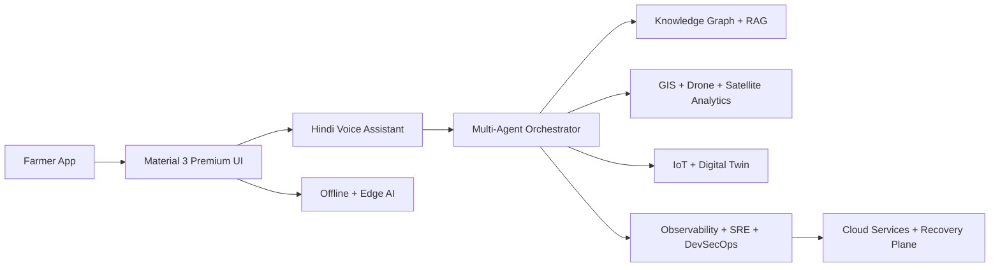
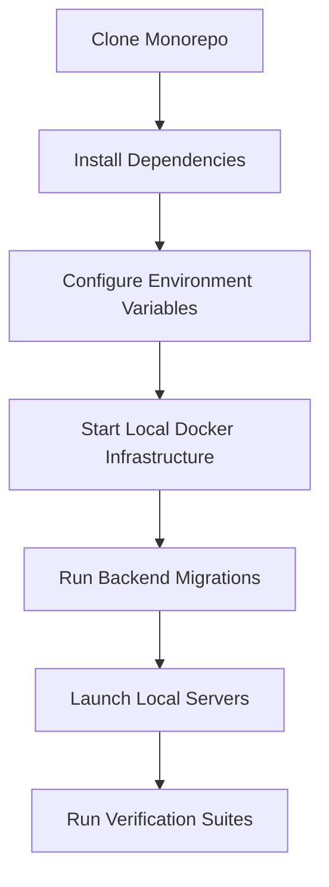

# KISAN GURU AI - SYSTEM ARCHITECTURE DOCUMENT
## Production-Ready Smart Farming Ecosystem Architectural Blueprint

---

## SECTION 1: Project Architecture & Rationales

Kisan Guru AI utilizes a hybrid architectural style to address offline capabilities, low-bandwidth internet connectivity in rural areas, real-time localized AI inference, and complex transaction matching for machinery rentals.

```
+---------------------------------------------------------------------------------+
|                                 HIGH-LEVEL FLUTTER FRONTEND                     |
|                                                                                 |
|    +-----------------------------+               +-------------------------+    |
|    |      Presentation Layer     | <===========> |     On-Device Storage   |    |
|    |  (UI, Localization, BLoC)   |               |   (SQLCipher / SQLite)  |    |
|    +-----------------------------+               +-------------------------+    |
|                   ^                                           ^                 |
|                   | (Sync Outbox Queue)                       |                 |
|                   v                                           v                 |
|    +-----------------------------------------------------------------------+    |
|    |                              Data Layer                               |    |
|    |                 (Repositories, Local/Remote Sources)                  |    |
|    +-----------------------------------------------------------------------+    |
+---------------------------------------------------------------------------------+
                                      |
                      (Secure HTTPS / Websockets API)
                                      v
+---------------------------------------------------------------------------------+
|                                 FASTAPI BACKEND GATEWAY                         |
|                                                                                 |
|  +---------------------+   +---------------------+   +-----------------------+  |
|  |     API Routers     |   | JWT Authentication  |   |   Response Formatting |  |
|  |  (Asynchronous IO)  |   |   (Token Rotation)  |   |   & Error Handlers    |  |
|  +---------------------+   +---------------------+   +-----------------------+  |
+---------------------------------------------------------------------------------+
          |                                                |
          v (Query & Transactions)                         v (Task Scheduling)
+------------------------------------+          +---------------------------------+
|        DATABASE STORAGE            |          |     CELERY DISTRIBUTED POOL     |
|                                    |          |                                 |
|  * PostgreSQL (Relational)         |          |  * Redis Broker                 |
|  * PostGIS (Geospatial listings)   |          |  * PyTorch YOLO (Crop/Animal)   |
|  * TimescaleDB (IoT & Weather)     |          |  * Whisper & TTS (Speech AI)    |
|  * WAL-G (Continuous Backups)      |          |  * RAG Pipeline (ICAR Manuals)  |
+------------------------------------+          +---------------------------------+
```

### 1. High-Level Architecture
The system follows a **Mobile-First Client-Server Architecture** operating under an **Offline-First Synchronizer Pattern**.
* **Client Side**: Mobile application developed in Flutter. It communicates with the backend asynchronously using standard REST APIs and WebSockets. It hosts local AI inference models (TensorFlow Lite YOLO) and a local SQLite database for offline operations.
* **Server Side**: A clean FastAPI backend cluster behind an Nginx reverse proxy. API requests are verified through JWT tokens. High-load operations like heavy deep learning analysis (Whisper, high-resolution YOLO detection, LLM RAG queries) are offloaded to Celery workers backed by a Redis message broker.

### 2. Low-Level Architecture
Internally, each module in both the frontend and backend is separated using **Domain-Driven Design (DDD)** concepts:
* **Entities**: Core business objects (e.g., `Crop`, `User`, `RentalBooking`, `AnimalDiagnostics`).
* **Value Objects**: Immutable properties (e.g., `GeospatialLocation`, `IndianCurrency`).
* **Aggregates**: Clusters of domain objects treated as a single transactional unit (e.g., a `RentalBooking` containing a `MachineOwner`, a `FarmHelper`, and a `PaymentEscrow`).
* **Repositories**: Abstract contracts defining how data is retrieved, isolating domain logic from framework databases (PostgreSQL or SQLite).

### 3. Layered Architecture
Each micro-module enforces strict layers where dependencies point only inwards:
1. **API / Presentation Layer**: Deals with routing inputs, WebSockets, HTTP requests, UI widgets, and state representation.
2. **Application / Use Case Layer**: Contains system-specific business rules and orchestrates data flow between domain entities and repository interfaces.
3. **Domain Layer**: The core business logic, validation rules, and base entity structures. Free from external libraries or framework dependencies.
4. **Infrastructure Layer**: Concrete implementations of repositories, database connections, API clients, S3 storage interfaces, and telemetry logging configurations.

### 4. Clean Architecture
By utilizing Clean Architecture, we guarantee that the framework can change without breaking business rules:
* **Independence**: The database, UI, and external AI services are completely decoupled. If we migrate from PostgreSQL to another data store, or swap Firebase Storage for AWS S3, only the Infrastructure layer is modified.
* **Testability**: The core application logic (e.g., calculating calendar irrigation notifications or crop rental fees) can be unit-tested in isolation without mocking a database or running a server.

### 5. Modular Architecture
The codebase is structured into self-contained vertical feature modules (e.g., `auth`, `crop_management`, `animal_health`, `machinery_rental`).
* **Isolation**: A bug in the machinery rental module will not crash the core authentication or calendar system.
* **Scalability**: High-traffic features can be extracted into standalone microservices if traffic spikes, with minimal refactoring.

### 6. Enterprise AI, UX, and Operations Blueprint
The platform is designed as a hybrid cloud-edge intelligence fabric for rural deployment. The architecture combines multi-agent orchestration, knowledge graphs, GIS, IoT telemetry, drone/satellite analytics, and a premium farmer experience into one operating model.



#### AI Reliability & Intelligence Design
* **Agent Responsibilities**: Crop disease analysis, irrigation planning, pest advisory, animal health triage, rental matching, and anomaly detection each run through specialized agents.
* **Explainability**: Recommendations include evidence sources, confidence scores, and localized action steps so farmers can trust the system.
* **Data Engineering**: Structured farm records, sensor streams, weather history, geospatial imagery, and multilingual chat transcripts are unified into a secure lakehouse and event pipeline.

#### User Experience & Accessibility Design
* **Premium Visual System**: Rounded cards, soft elevation, glassmorphism-inspired surfaces, accessible color contrast, responsive layouts, dark/light/high-contrast themes, and smooth micro-interactions define the interface.
* **Farmer-Centered Interaction**: Hindi-first onboarding, audio-first help, large touch targets, spoken confirmations, and low-friction error handling are mandatory for adoption.
* **Localization Framework**: A central localization engine supports Hindi, English, Bhojpuri, Awadhi, and future regional expansion without hard-coding text in UI components.

#### Security, Governance & Operations
* **Zero Trust Security**: Mutual TLS, short-lived tokens, device trust checks, API rate limiting, and least-privilege RBAC enforce secure access.
* **Observability & AIOps**: Metrics, traces, logs, SLOs, synthetic checks, alert correlation, and automated remediation are part of the baseline operating model.
* **Resilience**: Circuit breakers, idempotent APIs, queue backpressure handling, GRPC/HTTP fallback modes, and multi-region backup strategies protect against failures.

---

## SECTION 2: Complete Project Folder Structure

### 1. Backend: FastAPI Clean Modular Layout
```text
fastapi-backend/
├── app/
│   ├── core/                      # Global configurations, security, base exception models
│   │   ├── config.py              # Dynamic env parsing via Pydantic settings
│   │   ├── database.py            # Async engine and engine session pool lifecycle
│   │   └── security.py            # Hashing passwords, generating/decoding JWT access and refresh tokens
│   │
│   ├── modules/                   # Modular features
│   │   ├── auth/                  # Phone OTP and JWT Auth Module
│   │   │   ├── domain/
│   │   │   │   ├── entities.py
│   │   │   │   └── interfaces.py
│   │   │   ├── application/
│   │   │   │   └── use_cases.py
│   │   │   ├── infrastructure/
│   │   │   │   ├── models.py      # SQLAlchemy ORM schemas
│   │   │   │   └── repositories.py
│   │   │   └── presentation/
│   │   │       ├── router.py      # FastAPI HTTP Endpoints
│   │   │       └── schemas.py     # Pydantic Request/Response DTOs
│   │   │
│   │   ├── crop_management/       # YOLOv8 disease prediction, calendars, advisories
│   │   │   ├── domain/
│   │   │   ├── application/
│   │   │   ├── infrastructure/
│   │   │   └── presentation/
│   │   │
│   │   └── machinery_rental/      # PostGIS geo-indexed machinery listings & transactions
│   │       ├── domain/
│   │       ├── application/
│   │       ├── infrastructure/
│   │       └── presentation/
│   │
│   ├── workers/                   # Celery worker processes
│   │   ├── celery_app.py          # Celery configuration and Redis task registration
│   │   ├── ai_tasks.py            # Deep learning inference execution tasks (YOLO, Whisper)
│   │   └── notification_tasks.py  # Background Push notification schedules via FCM
│   │
│   └── main.py                    # Root initialization, CORS middlewares, global exception interception
│
├── tests/                         # Test suites mimicking module structure
│   ├── conftest.py                # Test client hooks, mock databases, and seed scripts
│   ├── test_auth.py
│   └── test_machinery_rental.py
│
├── .env.example                   # Baseline environment variables template
├── Dockerfile                     # Multi-stage optimized builder
└── requirements.txt               # Pin-pointed Python libraries
```

### 2. Frontend: Flutter Modular Architecture
```text
flutter-frontend/
├── assets/
│   ├── icons/                     # UI Icons in vector formats (SVG)
│   ├── images/                    # Local asset imagery
│   └── models/                    # TF-Lite YOLOv8 model weights for offline inference
│
├── lib/
│   ├── core/                      # Global theme constants, network interceptors, shared utilities
│   │   ├── network/               # Dio HTTP client, custom retry hooks, offline-cache policies
│   │   ├── theme/                 # Harmonious high-contrast light and dark styling configurations
│   │   └── error/                 # Global UI error definitions
│   │
│   ├── features/                  # Highly isolated vertical functional slices
│   │   ├── auth/                  # Registration, local secure token store, PIN entries
│   │   │   ├── data/
│   │   │   │   ├── models/        # JSON parsing data objects
│   │   │   │   ├── datasources/   # Local (Secure Storage) and Remote sources
│   │   │   │   └── repositories/  # Repository implementations
│   │   │   ├── domain/
│   │   │   │   ├── entities/      # Pure clean user representation
│   │   │   │   ├── repositories/  # Interface boundaries
│   │   │   │   └── usecases/      # Verification, logic
│   │   │   └── presentation/
│   │   │       ├── bloc/          # Flutter BLoC state controller
│   │   │       ├── screens/       # Views (OTP Verification screen)
│   │   │       └── widgets/       # UI building components
│   │   │
│   │   ├── crop_disease/          # Camera interface, crop scanner (online/offline)
│   │   │   ├── data/
│   │   │   ├── domain/
│   │   │   └── presentation/
│   │   │
│   │   └── machinery_rental/      # List and book farm vehicles
│   │       ├── data/
│   │       ├── domain/
│   │       └── presentation/
│   │
│   └── main.dart                  # Core bootstrap and environment initialization
│
├── test/                          # Unit and Golden UI widget test structures
├── pubspec.yaml                   # Dart dependency list
└── analysis_options.yaml          # Strict Dart static analyzer rules
```

---

## SECTION 3: System Dependencies

### 1. Backend (FastAPI `requirements.txt`)
* `fastapi==0.111.0` - Modern, high-performance web framework.
* `uvicorn[standard]==0.30.1` - Fast ASGI web server.
* `sqlalchemy[asyncio]==2.0.30` - Modern SQL database toolkit with full async mapping.
* `asyncpg==0.29.0` - Fast asynchronous PostgreSQL client library.
* `pydantic-settings==2.3.1` - Type-safe environment validation.
* `jose==3.3.0` - JWT sign, verify, and session validation.
* `passlib[bcrypt]==1.7.4` - Hash security for database storage.
* `celery==5.4.0` - Task queue processing daemon.
* `redis==5.0.5` - High-throughput key-value engine and task queue broker.
* `opencv-python-headless==4.9.0.80` - Machine Vision preprocessing library (no GUI dependencies).
* `ultralytics==8.2.28` - Advanced YOLOv8 packaging for model loading and pipeline processing.
* `torch==2.3.1` - Underlying tensor processing framework.

### 2. Frontend (Flutter `pubspec.yaml`)
* `flutter_bloc: ^8.1.6` - Business Logic Component pattern implementation.
* `dio: ^5.5.0` - Clean network communication interface with built-in token interceptors.
* `sqflite: ^2.3.3` - Relational storage wrapper.
* `flutter_secure_storage: ^9.2.2` - Keychain/Keystore wrapper to lock down tokens.
* `tflite_flutter: ^0.10.4` - Low-overhead native bindings to TF-Lite engine for client-side YOLO.
* `google_maps_flutter: ^2.6.2` - Visual representation of nearby machinery listings.
* `speech_to_text: ^6.6.0` - Local voice extraction services.
* `flutter_tts: ^4.0.2` - Read alerts back to farmers in local dialects.

---

## SECTION 4: Coding Standards & Naming Conventions

### 1. Python Code Standards (FastAPI)
* **Formatting**: Enforced via `black` (line limit: 88 characters).
* **Typing**: Strict type hints are required on all function signatures. Verify types using `mypy`.
* **Async Functions**: All endpoints interfacing with relational data or network assets must use `async/await` syntax to prevent thread stalling.

#### Python Naming Conventions
* **Files**: `snake_case.py` (e.g., `user_repository.py`).
* **Classes**: `PascalCase` (e.g., `GetCropDiseases`).
* **Variables / Functions**: `snake_case` (e.g., `verify_otp_code`).
* **Constants**: `UPPER_SNAKE_CASE` (e.g., `JWT_EXPIRATION_MINUTES`).

### 2. Dart Code Standards (Flutter)
* **Formatting**: Formatted using the native `flutter format` command.
* **Linting**: Rules declared inside `analysis_options.yaml` (rejecting implicit casts, enforcing const constructors).
* **State Management**: BLoC logic must only emit immutable states. UI components must be kept stateless (inheriting from `StatelessWidget`), reading layout changes via `BlocBuilder`.

#### Dart Naming Conventions
* **Files**: `snake_case.dart` (e.g., `auth_repository_impl.dart`).
* **Classes**: `PascalCase` (e.g., `TomatoScannerScreen`).
* **Variables / Methods**: `camelCase` (e.g., `getCurrentLocation`).
* **Constants**: `camelCase` starting with lowercase (e.g., `primaryLightColor`).

### 3. Database Conventions (PostgreSQL)
* **Table Names**: Pluralized, `snake_case` (e.g., `rental_bookings`).
* **Columns**: `snake_case` (e.g., `owner_id`, `created_at`).
* **Primary Keys**: Named `id` (UUIDv7 for secure, chronological sorting).
* **Foreign Keys**: Plural base + `_id` suffix (e.g., `user_id` referencing `users.id`).

---

## SECTION 5: Git Strategy & Conventional Commits

We use **GitFlow**. Development is carried out in isolated feature branches derived from `develop` and merged via verified Pull Requests (PRs).

### Commit Message Template
```text
<type>(<scope>): <subject>

[optional body]

[optional footer(s)]
```

### Supported Commit Types
* `feat`: A new feature implementation (e.g., `feat(rental): add PostGIS geo-radius calculations`).
* `fix`: A hotfix or bug repair (e.g., `fix(auth): correct token rotation token blacklisting`).
* `docs`: Documentation adjustment (e.g., `docs(readme): add docker setup details`).
* `refactor`: Structural rewrite that does not add features or fix bugs (e.g., `refactor(db): modularize connection pooling`).
* `test`: Adding or correcting tests (e.g., `test(bloc): implement auth bloc unit coverage`).

---

## SECTION 6: Environment Configurations

Configurations are injected via environment files. All environment keys must be validated on system start.

### Unified `.env` Design template
```ini
# --- GLOBAL RUNTIME CONFIG ---
ENV=production
DEBUG=false
SECRET_KEY=9a7c36192db84b2e88a562137bc0f70c3298a8342718e809cd8015c928de6840

# --- POSTGRES ENGINE CONFIG ---
POSTGRES_USER=kisan_guru_admin
POSTGRES_PASSWORD=kisan_secure_db_pass_2026
POSTGRES_DB=kisan_guru_prod
POSTGRES_HOST=postgres-db
POSTGRES_PORT=5432
DATABASE_POOL_SIZE=40
DATABASE_MAX_OVERFLOW=20

# --- REDIS MEMORY QUEUE CONFIG ---
REDIS_HOST=redis-cache
REDIS_PORT=6379
REDIS_PASSWORD=kisan_secure_redis_pass_2026

# --- AI WORKLOAD CONFIG ---
YOLO_CONFIDENCE_THRESHOLD=0.75
WHISPER_MODEL_PATH=/app/models/whisper_base_indian.onnx
LLM_API_KEY=sk-proj-LLMSecretAPIKeyUsedForRAGVectorLookups
VECTOR_DB_URL=http://qdrant-vector-db:6333

# --- PUSH NOTIFICATION ---
FIREBASE_SERVICE_ACCOUNT_JSON={"type": "service_account", ...}
```

---

## SECTION 7: Local Development Workflow

Follow this workflow to set up the development environment:



### Detailed Setup Steps
1. **Initialize DB**: Spin up local backing containers (Postgres, PostGIS, Redis) via Docker:
   ```bash
   docker-compose -f docker-compose.dev.yml up -d
   ```
2. **Backend Migrations**: Run database schemas using Alembic:
   ```bash
   cd fastapi-backend
   pip install -r requirements.txt
   alembic upgrade head
   python -m app.main
   ```
3. **Frontend Mobile Launch**: Set up Dart and run the compiler:
   ```bash
   cd flutter-frontend
   flutter pub get
   flutter run
   ```

---

## SECTION 8: Production Best Practices

### 1. Docker Multi-Stage Builds (FastAPI)
The backend uses multi-stage builds to optimize image size and security.
* **Stage 1 (Builder)**: Installs build dependencies (gcc, python-dev) and compiles wheels.
* **Stage 2 (Runner)**: Copies only compiled wheels, runs as a non-privileged `appuser`, and exposes port 8000. This minimizes the attack surface.

### 2. High-Performance SQL Optimization
* **Connection Pooling**: Uses `SQLAlchemy`'s async engine configuration with a custom connection pool size.
* **Database Indexing**: Enforce B-Tree indexing on frequently queried columns (`user_id`, `booking_date`) and GIST index on geospatial fields (`machine_location`).

### 3. Queue Orchestration & Circuit Breakers
* **Telemetry Task Broker**: Scale Celery workers independently of the FastAPI gateway.
* **Rate Limiting**: Integrated Redis token bucket filter to mitigate DoS vectors.
* **Sentry Logging Integration**: Centralized dashboard capture tracking p95 response metrics and critical stack traces automatically.
