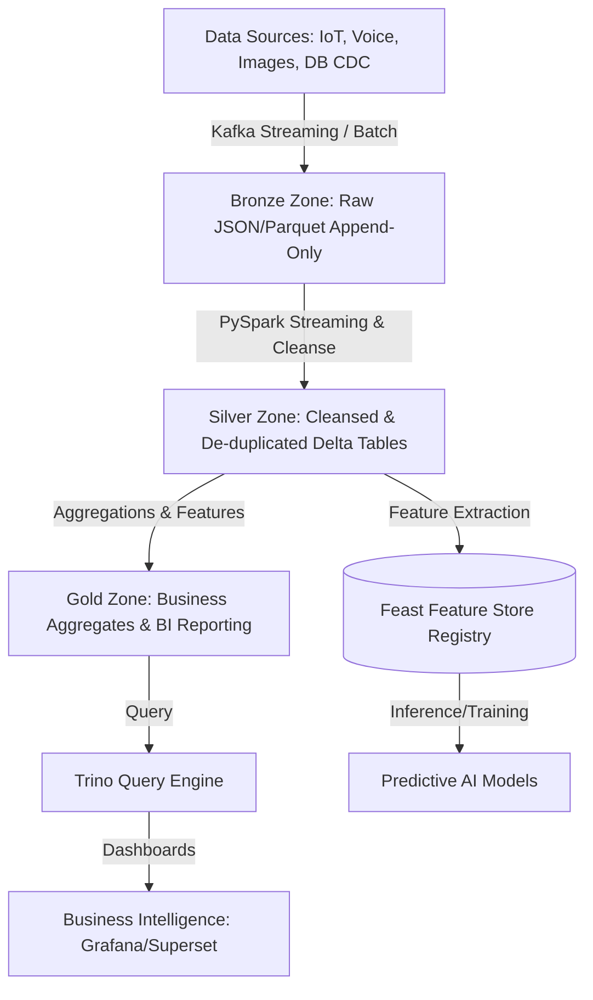
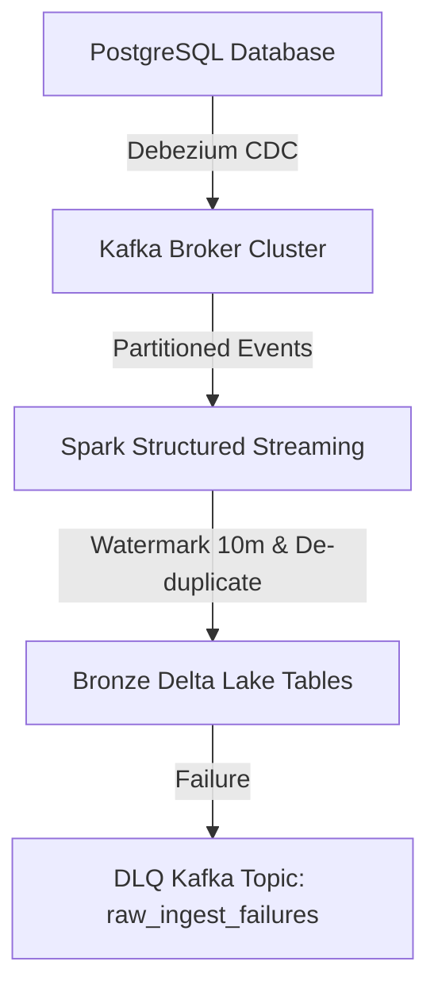
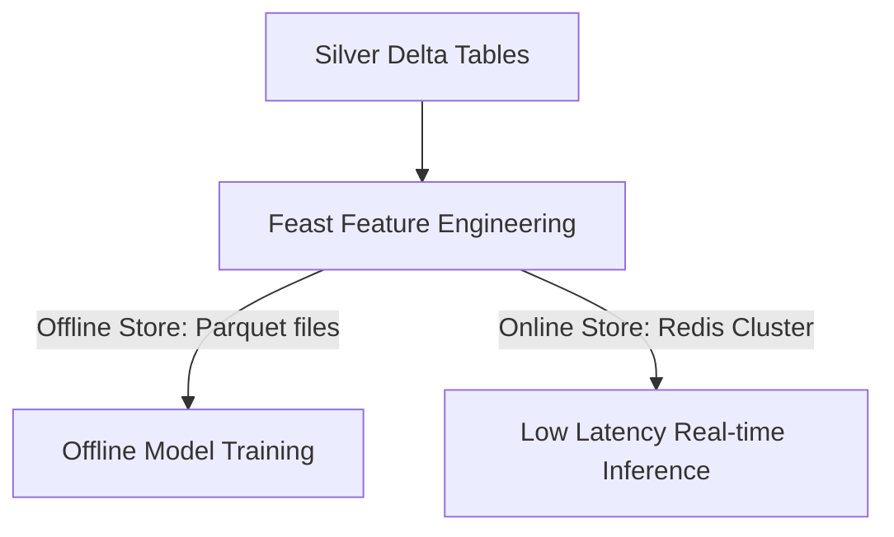
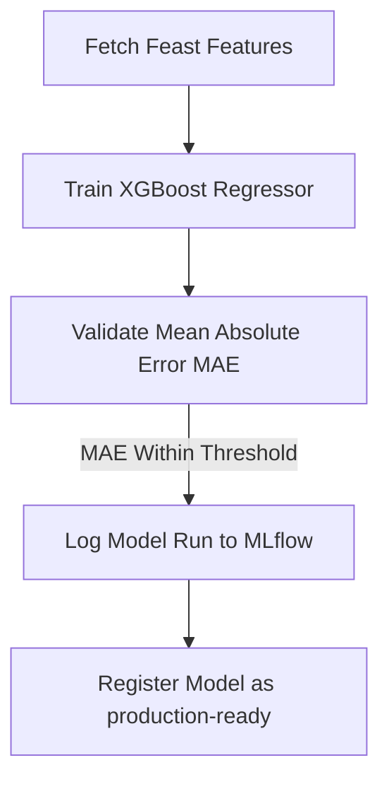
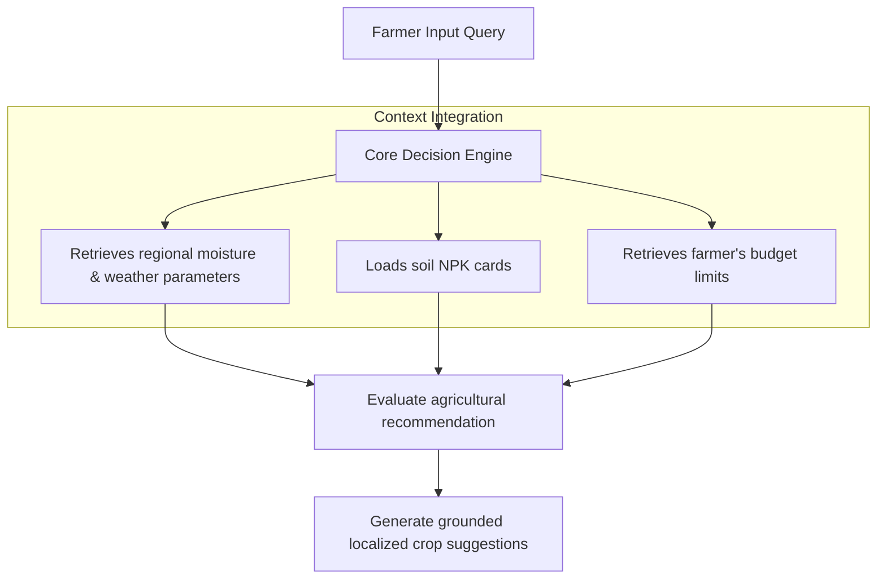

# CONFIDENTIAL ENTERPRISE DATA PLATFORM & LAKEHOUSE SPECIFICATION
## SYSTEM: Kisan Guru AI Data Platform, Lakehouse & Analytics (AgriOS)
**Document Reference: KG-AgriOS-Data-Lakehouse-1.0.0**  
**Classification: Internal Proprietary & Confidential**  
**Target Audience: Data Engineers, Data Architects, Data Scientists, BI Developers, SREs**

---

## 1. Enterprise Data Platform Topology

AgriOS uses a **Medallion Lakehouse Architecture** built on Delta Lake and Apache Spark to process petabytes of agricultural data.



### Data Platform Layers
* **Bronze Zone (Raw)**: Captures raw ingestion events (such as JSON API payloads, telemetry streams, and image metadata) as append-only records.
* **Silver Zone (Cleanse)**: Standardizes data schemas, resolves missing fields, and removes duplicate entries.
* **Gold Zone (Curated)**: Stores business-level aggregations (e.g., weekly regional yield estimates) optimized for business intelligence queries.

---

## 2. Data Sources

The platform processes data from diverse ingestion channels to support analytics and decision-making:

| Data Source | Format | Ingestion Frequency | Ingestion Mechanism |
| :--- | :--- | :--- | :--- |
| **IoT Soil Sensors** | JSON / Protobuf | Every 5 minutes | MQTT broker to Kafka Stream |
| **Weather APIs (IMD)**| JSON | Hourly | Scheduled Apache Airflow fetch |
| **Mobile Leaf Images**| JPEG / PNG | On-demand (User Upload) | S3 Event Trigger to Kafka |
| **Voice Transcripts** | WAV / Opus | On-demand (User Upload) | WebSockets to Object Storage |
| **APMC Market Price** | CSV / JSON | Daily | Web Scraping & API Poll |
| **Govt Scheme Records**| XML / JSON | Weekly | SFTP Upload & CDC |

---

## 3. Data Ingestion

Kafka clusters capture incoming database transactions and streaming telemetry logs in real time.



### Kafka Ingestion & CDC Routing
* **Kafka Event Partitioning**: Topics are partitioned by district code (`ap-south-1.patna`) to distribute processing loads.
* **CDC Ingestion**: Debezium captures database updates and publishes change-data-capture logs directly to Kafka.

---

## 4. Data Lakehouse Design

Data is organized using Delta Lake partition patterns to optimize query performance.

### Lakehouse Partitioning Schema
Data is partitioned hierarchically by region and date to support efficient queries:
```text
s3://kisan-guru-lakehouse/
├── bronze/
│   └── raw_sensor_logs/
│       └── year=2026/
│           └── month=07/
│               └── district=patna/
│                   └── part-001.parquet
├── silver/
│   └── cleansed_crop_ledger/
└── gold/
    └── regional_yield_aggregates/
```

### Delta Lake DDL Definition
```sql
CREATE TABLE IF NOT EXISTS silver.crop_ledger (
    record_id STRING,
    farmer_id STRING,
    crop_type STRING,
    action_performed STRING,
    acreage DOUBLE,
    created_timestamp TIMESTAMP
) 
USING DELTA
PARTITIONED BY (crop_type)
LOCATION 's3://kisan-guru-lakehouse/silver/crop_ledger'
TBLPROPERTIES (
    'delta.logRetentionDuration' = 'interval 30 days',
    'delta.deletedFileRetentionDuration' = 'interval 7 days'
);
```

---

## 5. ETL / ELT Pipelines

PySpark pipelines process raw logs, clean schemas, and compute curated metrics.

### PySpark Streaming ETL Template
```python
from pyspark.sql import SparkSession
from pyspark.sql.functions import col, from_json, current_timestamp
from pyspark.sql.types import StructType, StructField, StringType, DoubleType

# Initialize Spark Session configured for Delta Lake
spark = SparkSession.builder \
    .appName("AgriOS-Telemetry-Ingestion") \
    .config("spark.sql.extensions", "io.delta.sql.DeltaSparkSessionExtension") \
    .config("spark.sql.catalog.spark_catalog", "org.apache.spark.sql.delta.catalog.DeltaCatalog") \
    .getOrCreate()

# Define schema for raw sensor data
sensor_schema = StructType([
    StructField("sensor_id", StringType(), True),
    StructField("moisture_level", DoubleType(), True),
    StructField("temperature", DoubleType(), True),
    StructField("timestamp", StringType(), True)
])

# Read streaming data from Kafka
raw_stream = spark.readStream \
    .format("kafka") \
    .option("kafka.bootstrap.servers", "kafka-broker.production:9092") \
    .option("subscribe", "telemetry.sensors") \
    .load()

# Parse JSON payloads and write to Delta table
parsed_stream = raw_stream \
    .selectExpr("CAST(value AS STRING) as json_payload") \
    .select(from_json(col("json_payload"), sensor_schema).alias("data")) \
    .select("data.*") \
    .withColumn("ingested_at", current_timestamp())

query = parsed_stream.writeStream \
    .format("delta") \
    .outputMode("append") \
    .option("checkpointLocation", "s3://kisan-guru-lakehouse/checkpoints/sensors/") \
    .start("s3://kisan-guru-lakehouse/silver/sensor_logs")

query.awaitTermination()
```

### Apache Airflow Orchestration DAG
```python
from datetime import datetime, timedelta
from airflow import DAG
from airflow.providers.apache.spark.operators.spark_submit import SparkSubmitOperator

default_args = {
    'owner': 'data_engineering',
    'depends_on_past': False,
    'start_date': datetime(2026, 7, 1),
    'retries': 2,
    'retry_delay': timedelta(minutes=5),
}

with DAG(
    'agrios_medallion_gold_pipeline',
    default_args=default_args,
    schedule_interval='@daily',
    catchup=False
) as dag:

    compute_gold_metrics = SparkSubmitOperator(
        task_id='calculate_weekly_yields',
        application='s3://kisan-guru-jobs/spark/weekly_yield_aggregate.py',
        conn_id='spark_default',
        verbose=True
    )
```

---

## 6. AI Feature Store

We use Feast to manage feature registries and serve features for training and real-time inference.



### Feast Feature Store Configuration (feature_store.yaml)
```yaml
project: agrios_feature_store
registry: s3://kisan-guru-ml/feature_store/registry.db
provider: aws
online_store:
  type: redis
  connection_string: redis-features.production.svc.cluster.local:6379,password=secure
offline_store:
  type: file
```

---

## 7. Analytics Platform

The platform processes streaming sensor data and aggregates records to support real-time monitoring and reporting.

### Operational Analytics Pipeline
1. **Real-time Stream**: Aggregates regional soil moisture levels over 10-minute sliding windows to detect anomalies.
2. **Aggregated OLAP Store**: Ingests structured transactions into ClickHouse to support fast dashboard queries.

---

## 8. Business Intelligence

Grafana and Apache Superset display key performance indicators and system monitoring dashboards.

### BI Executive Dashboard Layout
```
+---------------------------------------------------------------------------------+
| AGRIOS EXECUTIVE PERFORMANCE METRICS                                            |
+---------------------------------------------------------------------------------+
| Active Farmers: 102,492,019                 Weekly Yield Estimate: 4.2M Metric T|
| Diagnostic Scans: 1,420,129/day             Active Marketplace Listings: 42,901 |
+---------------------------------------------------------------------------------+
|                                                                                 |
| [ REGIONAL YIELD DISTRIBUTIONS ]                                                |
|  * Bihar State: Wheat yields up 12%         [==================== ]             |
|  * Uttar Pradesh: Rice yields up 8%         [==================   ]             |
|  * Madhya Pradesh: Crop damage alerts 1.2%  [=                    ]             |
|                                                                                 |
| [ ACTIVE INFECTION HEATMAPS ]                                                   |
|  * Tomato Late Blight Outbreak Risk: Nalanda District (HIGH RISK)               |
|  * Potato Pest Alerts: Indore District (LOW RISK)                               |
+---------------------------------------------------------------------------------+
```

---

## 9. Predictive Analytics

We use MLflow to train and version yield forecasting and crop recommendation models.



---

## 10. Data Governance

We use Apache Atlas to catalog metadata, map data lineage, and enforce security classifications.

### Data Classification Catalog
* **Tier 1 (PII)**: Farmer phone numbers, names, GPS coordinates, bank details. Masking and column-level encryption are required.
* **Tier 2 (Agronomic Data)**: Crop yields, soil NPK levels, localized weather history. Restricted access using RBAC permissions.
* **Tier 3 (Public)**: APMC market prices, government policy details. Read access granted to all users.

---

## 11. Security

Row-level security and column-level masking protect farmer PII and sensitive transactions.

### Row-Level Security Definition (PostgreSQL)
```sql
-- Enable Row Level Security on farmer profile table
ALTER TABLE farmer_profiles ENABLE ROW LEVEL SECURITY;

-- Create policy allowing farmers to only view their own profile record
CREATE POLICY farmer_profile_isolation_policy ON farmer_profiles
    FOR ALL
    TO authenticated_farmers
    USING (phone_number = current_setting('request.jwt.claim.phone_number', true));
```

---

## 12. AI Decision Intelligence

The decision engine combines weather history, soil profiles, and financial limits to generate localized suggestions.



---

## 13. Data Quality

Great Expectations runs automated assertions on incoming datasets to enforce data quality standards.

### Great Expectations Rule Spec (json_suite.json)
```json
{
  "expectation_suite_name": "silver_crop_ledger_validation",
  "expectations": [
    {
      "expectation_type": "expect_column_values_to_not_be_null",
      "kwargs": {
        "column": "farmer_id"
      }
    },
    {
      "expectation_type": "expect_column_values_to_be_in_set",
      "kwargs": {
        "column": "crop_type",
        "value_set": ["rice", "wheat", "tomato", "potato", "maize"]
      }
    },
    {
      "expectation_type": "expect_column_min_to_be_between",
      "kwargs": {
        "column": "acreage",
        "min_value": 0.05,
        "max_value": 1000.0
      }
    }
  ]
}
```

---

## 14. Folder Structure

We organize data engineering and pipeline scripts using a structured layout.

```text
agrios-data-lakehouse/
├── ingestion/                     # Kafka Streaming Connectors
├── lakehouse-schemas/             # Delta DDL and partitioning rules
├── spark-jobs/                    # PySpark Transformations
│   ├── clean_crop_ledger.py
│   └── weekly_yield_aggregate.py
├── airflow-dags/                  # Workflows & DAG Orchestration
│   └── daily_medallion_dag.py
├── feature-store/                 # Feast Configurations
│   ├── feature_store.yaml
│   └── features.py
└── data-quality/                  # Great Expectations Assertions
    └── crop_validation_rules.json
```

---

## 15. Performance & Scalability

We use Z-Ordering and partitioning optimizations to accelerate query performance across large datasets.

### Lakehouse Optimization Configurations
* **Z-Ordering Indexes**: We apply Z-Ordering on primary search columns (`farmer_id`, `crop_type`) to optimize data layout and speed up queries.
* **Auto Optimize**: Delta tables are configured to automatically compact small files during write operations:
```sql
ALTER TABLE silver.crop_ledger SET TBLPROPERTIES (
    'delta.autoOptimize.optimizeWrite' = 'true',
    'delta.autoOptimize.autoCompact' = 'true'
);
```

---

## 16. Future Platform

AgriOS is designed to support emerging technologies that will expand system capabilities.

### Future Integrations
* **Digital Twin Farm Models**: Simulating crop growth patterns based on environmental data and moisture levels.
* **Satellite Analysis Pipelines**: Processing multi-spectral satellite imagery to track crop growth and detect stress anomalies.
* **Carbon Credit Registry**: Enforcing immutable verification records using blockchain ledgers to support farmer carbon credits.

---

## Production Readiness Checklist

Before data pipelines are deployed to production clusters, verify that the following tasks are complete:
- [ ] Delta table schemas and partitions are applied to storage buckets.
- [ ] Kafka topics are configured with matching partitions (`district` keys).
- [ ] Airflow DAG configurations are active and connections verified.
- [ ] Feast features are populated in the online Redis store.
- [ ] Great Expectations data quality checks are active and alerts verified.
