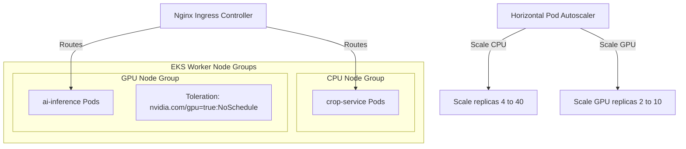
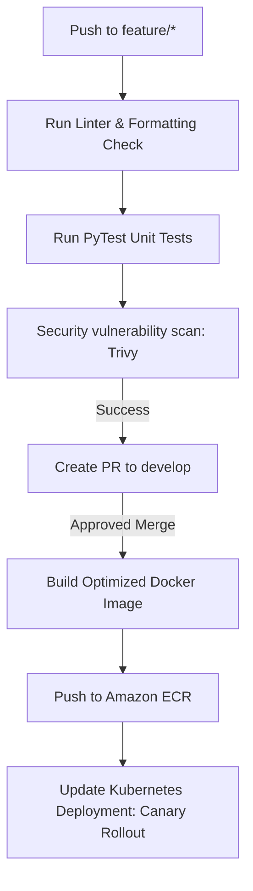
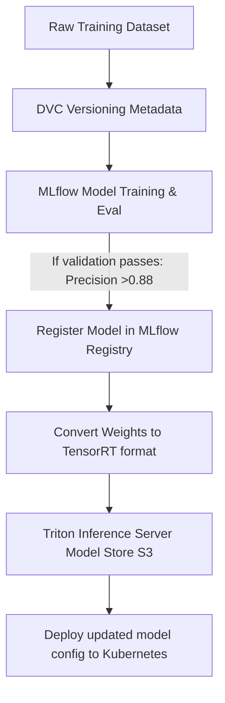
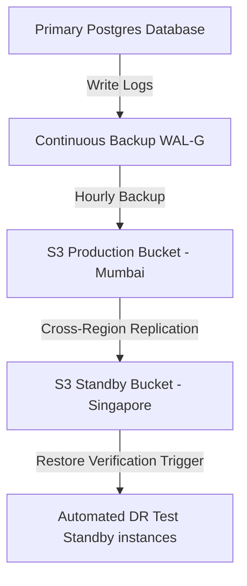
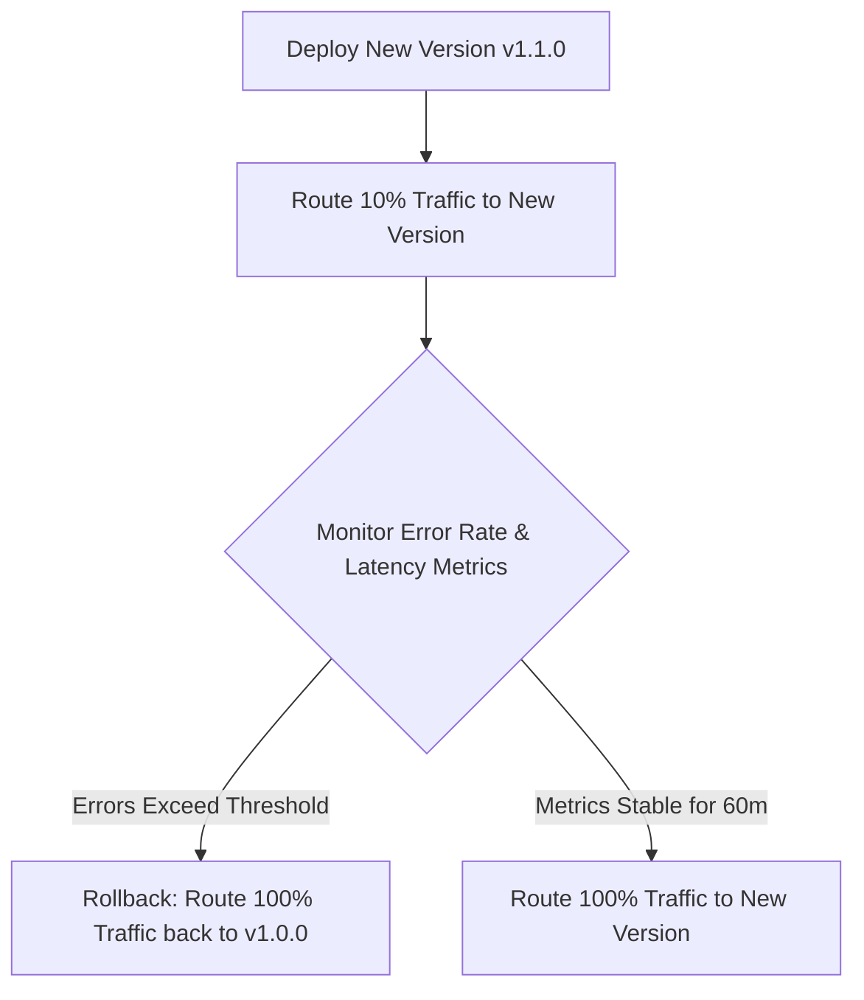

# CONFIDENTIAL ENTERPRISE DEVOPS, CLOUD INFRASTRUCTURE & MLOPS SPECIFICATION
## SYSTEM: Kisan Guru AI DevOps Foundation, Cloud & MLOps (AgriOS)
**Document Reference: KG-AgriOS-DevOps-MLOps-1.0.0**  
**Classification: Internal Proprietary & Confidential**  
**Target Audience: DevOps Engineers, Cloud Engineers, SREs, MLOps Specialists, Security Leads**

---

## 1. DevOps Architecture

AgriOS uses a standardized multi-environment deployment model designed to ensure reliability, security, and high availability.

```
+---------------------------------------------------------------------------------+
|                            ENVIRONMENTS & NETWORKING                            |
+---------------------------------------------------------------------------------+
|  [ AWS REGION: ap-south-1 (Mumbai) - Primary Production Site ]                  |
|  * Staging VPC (10.100.0.0/16): Subnets for QA, automated builds, testing.       |
|  * Production VPC (10.200.0.0/16): Private subnets, DB clusters, GPU node pools.|
+---------------------------------------------------------------------------------+
                                         |
                       Active-Passive Cross-Region Replication
                                         v
+---------------------------------------------------------------------------------+
|  [ AWS REGION: ap-southeast-1 (Singapore) - Disaster Recovery passive Site ]    |
|  * DR VPC (10.250.0.0/16): Passive standby database replicas, basic compute     |
|    nodes to restore operations if the primary region goes offline.               |
+---------------------------------------------------------------------------------+
```

### High Availability Details
* **Compute Modality**: EKS instances are distributed across three Availability Zones (ap-south-1a, ap-south-1b, ap-south-1c).
* **Network isolation**: Public subnets host only the load balancers and API gateways. Application servers, databases, and message brokers are isolated in private subnets with NAT gateways.

---

## 2. Kubernetes Architecture

AgriOS uses Kubernetes to manage container scaling, resource allocation, and service isolation.



### Taints and Tolerations
GPU node pools are tainted to ensure they only process heavy AI workloads:
* **Taint**: `nvidia.com/gpu=true:NoSchedule`
* **Toleration**: Specialized AI pods carry matching toleration parameters:
```yaml
tolerations:
  - key: "nvidia.com/gpu"
    operator: "Exists"
    effect: "NoSchedule"
```

### Pod Self-Healing & Health Probes Configuration
```yaml
apiVersion: apps/v1
kind: Deployment
metadata:
  name: crop-service
  namespace: production
spec:
  replicas: 4
  template:
    spec:
      containers:
        - name: app
          image: kisan-guru/crop-service:v1.0.0
          livenessProbe:
            httpGet:
              path: /health/liveness
              port: 8000
            initialDelaySeconds: 30
            periodSeconds: 15
          readinessProbe:
            httpGet:
              path: /health/readiness
              port: 8000
            initialDelaySeconds: 15
            periodSeconds: 10
```

---

## 3. Docker Infrastructure

AgriOS uses multi-stage builds to optimize Docker image sizes and security.

### Multi-Stage Python/FastAPI Dockerfile
```dockerfile
# Stage 1: Build Dependencies
FROM python:3.11-slim AS builder

WORKDIR /build

RUN apt-get update && apt-get install -y --no-install-recommends \
    gcc \
    python3-dev \
    libpq-dev \
    && rm -rf /var/lib/apt/lists/*

COPY requirements.txt .

# Compile Python wheels to speed up build
RUN pip install --no-cache-dir --user -r requirements.txt

# Stage 2: Final Run Image
FROM python:3.11-slim AS runner

WORKDIR /app

RUN apt-get update && apt-get install -y --no-install-recommends \
    libpq5 \
    && rm -rf /var/lib/apt/lists/*

# Copy compiled dependencies from builder stage
COPY --from=builder /root/.local /root/.local
COPY . .

ENV PATH=/root/.local/bin:$PATH
ENV PYTHONDONTWRITEBYTECODE=1
ENV PYTHONUNBUFFERED=1

# Expose server port
EXPOSE 8000

# Create and run as non-privileged app user
RUN useradd -u 8888 appuser && chown -R appuser:appuser /app
USER appuser

HEALTHCHECK --interval=30s --timeout=5s --start-period=5s --retries=3 \
  CMD curl -f http://localhost:8000/health/liveness || exit 1

ENTRYPOINT ["uvicorn", "app.main:app", "--host", "0.0.0.0", "--port", "8000"]
```

---

## 4. CI/CD Pipeline

AgriOS uses GitHub Actions to automate testing and application deployment.



### GitHub Actions Workflow (ci-cd-pipeline.yml)
```yaml
name: AgriOS Production CI/CD Pipeline

on:
  push:
    branches:
      - main
  pull_request:
    branches:
      - main

jobs:
  validate-and-test:
    runs-on: ubuntu-latest
    steps:
      - name: Checkout Code
        uses: actions/checkout@v3

      - name: Set up Python
        uses: actions/setup-python@v4
        with:
          python-version: '3.11'

      - name: Install dependencies
        run: |
          python -m pip install --upgrade pip
          pip install flake8 pytest pytest-cov
          if [ -f requirements.txt ]; then pip install -r requirements.txt; fi

      - name: Lint with flake8
        run: |
          # Stop build if there are Python syntax errors or undefined names
          flake8 . --count --select=E9,F63,F7,F82 --show-source --statistics
          # exit-zero treats warnings as errors
          flake8 . --count --exit-zero --max-complexity=10 --max-line-length=88 --statistics

      - name: Run Test Suite with Coverage
        run: |
          pytest --cov=app --cov-report=xml

      - name: Scan Docker Image with Trivy
        uses: aquasecurity/trivy-action@master
        with:
          image-ref: 'kisan-guru/crop-service:${{ github.sha }}'
          format: 'table'
          exit-code: '1'
          ignore-unfixed: true
          vuln-type: 'os,library'
          severity: 'CRITICAL,HIGH'

  deploy-to-eks:
    needs: validate-and-test
    if: github.ref == 'refs/heads/main' && github.event_name == 'push'
    runs-on: ubuntu-latest
    steps:
      - name: Configure AWS Credentials
        uses: aws-actions/configure-aws-credentials@v1
        with:
          aws-access-key-id: ${{ secrets.AWS_ACCESS_KEY_ID }}
          aws-secret-access-key: ${{ secrets.AWS_SECRET_ACCESS_KEY }}
          aws-region: ap-south-1

      - name: Login to Amazon ECR
        id: login-ecr
        uses: aws-actions/amazon-ecr-login@v1

      - name: Build, tag, and push image to Amazon ECR
        env:
          ECR_REGISTRY: ${{ steps.login-ecr.outputs.registry }}
          ECR_REPOSITORY: kisan-guru-crop-service
          IMAGE_TAG: ${{ github.sha }}
        run: |
          docker build -t $ECR_REGISTRY/$ECR_REPOSITORY:$IMAGE_TAG -t $ECR_REGISTRY/$ECR_REPOSITORY:latest .
          docker push $ECR_REGISTRY/$ECR_REPOSITORY:$IMAGE_TAG
          docker push $ECR_REGISTRY/$ECR_REPOSITORY:latest

      - name: Update Kubernetes Manifests
        run: |
          aws eks update-kubeconfig --name agrios-production-cluster --region ap-south-1
          kubectl set image deployment/crop-service crop-service-container=${{ steps.login-ecr.outputs.registry }}/kisan-guru-crop-service:${{ github.sha }} -n production
```

---

## 5. Infrastructure as Code (IaC)

We use Terraform to manage cloud resources and network configurations.

### Terraform Project Layout
```text
terraform/
├── main.tf                        # Root Provider config
├── variables.tf
├── outputs.tf
├── terraform.tfvars
└── modules/
    ├── vpc/                       # AWS VPC subnets & NAT Gateways
    │   ├── main.tf
    │   ├── variables.tf
    │   └── outputs.tf
    ├── eks/                       # EKS Cluster and Node Groups
    └── rds/                       # PostgreSQL Citus Database instances
```

### EKS Cluster Definition (modules/eks/main.tf)
```hcl
resource "aws_eks_cluster" "agrios_cluster" {
  name     = var.cluster_name
  role_arn = aws_iam_role.eks_cluster_role.arn
  version  = "1.27"

  vpc_config {
    subnet_ids              = var.private_subnets
    endpoint_private_access = true
    endpoint_public_access  = false
  }

  depends_on = [
    aws_iam_role_policy_attachment.eks_cluster_policy
  ]
}

resource "aws_eks_node_group" "gpu_workers" {
  cluster_name    = aws_eks_cluster.agrios_cluster.name
  node_group_name = "gpu-inference-nodes"
  node_role_arn   = aws_iam_role.node_group_role.arn
  subnet_ids      = var.private_subnets

  scaling_config {
    desired_size = var.gpu_desired_size
    max_size     = var.gpu_max_size
    min_size     = var.gpu_min_size
  }

  instance_types = ["g5.2xlarge"] # Nvidia A10G GPU nodes

  taint {
    key    = "nvidia.com/gpu"
    value  = "true"
    effect = "NO_SCHEDULE"
  }

  labels = {
    workload = "gpu-inference"
  }
}
```

---

## 6. Enterprise MLOps

AgriOS uses a centralized MLOps pipeline to register models, deploy inference services, and monitor performance.



### Triton Model Configuration File (config.pbtxt)
```protobuf
name: "tomato_early_blight_yolov8"
platform: "onnxruntime_onnx"
max_batch_size: 16

input [
  {
    name: "images"
    data_type: TYPE_FP32
    dims: [ 3, 640, 640 ]
  }
]

output [
  {
    name: "output0"
    data_type: TYPE_FP32
    dims: [ 1, 84, 8400 ]
  }
]

instance_group [
  {
    count: 2
    kind: KIND_GPU
  }
]

dynamic_batching {
  max_queue_delay_microseconds: 10000
}
```

---

## 7. Monitoring & Observability

We use Prometheus and Grafana to track system health and monitor resource usage.

### Prometheus Alerting Rules Configuration (prometheus-alerts.yml)
```yaml
groups:
  - name: gpu-monitoring-alerts
    rules:
      - alert: GPUTemperatureCritical
        expr: nv_gpu_temperature > 85
        for: 2m
        labels:
          severity: critical
        annotations:
          summary: "GPU Overheating Warning on {{ $labels.instance }}"
          description: "GPU core temperature has exceeded 85°C for more than 2 minutes."

      - alert: GPUMemoryOOMRisk
        expr: nv_gpu_memory_used_bytes / nv_gpu_memory_total_bytes * 100 > 90
        for: 5m
        labels:
          severity: warning
        annotations:
          summary: "GPU Memory Exhaustion Risk warning"
```

---

## 8. Logging

Logs are collected from all containers and forwarded to a central Elasticsearch cluster for searching and analysis.

### Structured Log Processing Pattern
```
[ Kubernetes Pod logs ] 
      |
      v (Vector / Logstash Agents)
[ Elasticsearch Data Nodes ] 
      |
      v (Kibana Search Interface)
[ DevOps Alert Dashboards ]
```

---

## 9. Security Infrastructure

We use NetworkPolicies and secrets managers to enforce Zero-Trust network security.

### Kubernetes NetworkPolicy Configuration
```yaml
apiVersion: networking.k8s.io/v1
kind: NetworkPolicy
metadata:
  name: database-isolation-policy
  namespace: production
spec:
  podSelector:
    matchLabels:
      app: postgres-db
  policyTypes:
    - Ingress
  ingress:
    # Allow incoming traffic only from designated backend pods
    - from:
        - podSelector:
            matchLabels:
              role: backend-service
      ports:
        - protocol: TCP
          port: 5432
```

---

## 10. Disaster Recovery

We use automated snapshot replication to enable fast recovery in the event of a regional outage.



### RTO and RPO Metrics
* **RPO (Recovery Point Objective)**: < 5 Minutes (continuous database replication).
* **RTO (Recovery Time Objective)**: < 4 Hours (automated failover to secondary region).

---

## 11. Performance Engineering

We optimize query performance, database caching, and GPU usage to maintain sub-second system response times.

### Performance Optimizations
* **Database Connection Pooling**: We configure `SQLAlchemy` with `pool_size=40` and `max_overflow=20` to prevent connection exhaustion.
* **Model Inference Batching**: Triton is configured with dynamic batching, queuing inputs for up to $10\text{ms}$ to process inferences in parallel.

---

## 12. Production Deployment

We use canary deployments to test updates with a small percentage of user traffic before rolling them out system-wide.



---

## 13. Cost Optimization

We use spot instances and storage lifecycle rules to optimize infrastructure costs.

### Cost Savings Settings
1. **Spot Instances**: Kubernetes worker node groups use Spot instances for non-critical workloads, reducing compute costs by up to 60%.
2. **S3 Storage Lifecycle Rules**: Uploaded images are transitioned to Glacier storage after 90 days, reducing storage costs by up to 70%.

---

## 14. Folder Structure

We organize infrastructure and deployment files using a structured monorepo layout.

```text
kisan-guru-ai-infrastructure/
├── terraform/                     # Terraform Configuration Directories
│   ├── modules/
│   └── environments/
│       ├── staging/
│       └── production/
│
├── kubernetes/                    # Kubernetes Manifests & Helm Charts
│   ├── ingress/
│   ├── deployments/
│   └── monitoring/
│       ├── prometheus-rules.yaml
│       └── grafana-dashboards/
│
├── mlops/                         # ML Pipelines & Model Store Configs
│   ├── triton-model-repository/
│   └── tracking/
│
└── .github/
    └── workflows/                 # CI/CD Workflows
        └── pipeline.yaml
```

---

## 15. Future Infrastructure

AgriOS is designed to support emerging technologies that will expand system capabilities.

### Future Integrations
* **Edge AI Modules**: Running lightweight models directly on edge devices to process requests without sending data to the cloud.
* **Satellite Analysis Pipelines**: Processing multi-spectral satellite imagery to track crop growth and map soil moisture levels.
* **Drone Swarm Flight Planners**: Shared coordinate directories to coordinate autonomous drone operations.

---

## Production Readiness Checklist

Before code is deployed to production clusters, verify that the following tasks are complete:
- [ ] Multi-stage Docker builds pass vulnerability checks without critical issues.
- [ ] Terraform configs are applied and cluster settings verified.
- [ ] NetworkPolicies are active and verified for database pods.
- [ ] Prometheus alert rules are verified in Kubernetes configurations.
- [ ] Disaster recovery backup schedules are active and verified.
