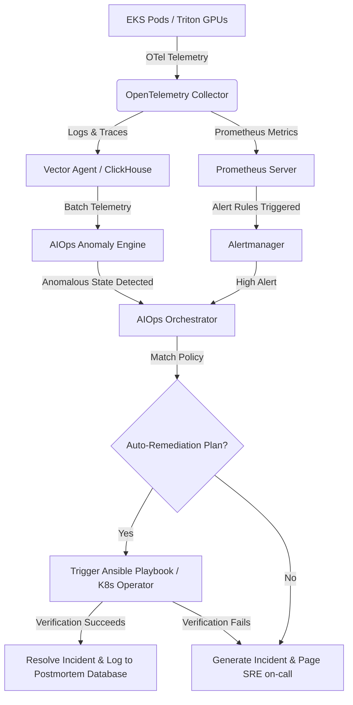
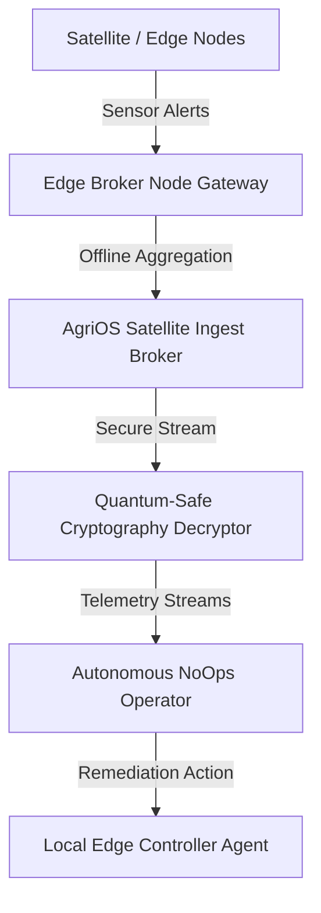

# CONFIDENTIAL ENTERPRISE OPERATIONS, SRE, PLATFORM ENGINEERING & GLOBAL OPERATIONS BLUEPRINT
## SYSTEM: AgriOS Enterprise Operations Platform
**Document Reference: KG-AgriOS-AIOps-SRE-Ops-1.0.0**  
**Classification: Internal Proprietary & Confidential**  
**Target Audience: SREs, AIOps Architects, Platform Engineers, Cloud Operations Teams, CTO**

---

## 1. Enterprise Operations Architecture

The AgriOS Enterprise Operations Platform uses a centralized Operations Control Center (OCC) integrated with self-healing automation loops, a robust AIOps telemetry engine, and Platform Engineering patterns. The platform is designed to maintain 99.99%+ availability for 100M+ farmers processing billions of requests globally.

### 1.1 Operations Control Center (OCC) Tiered Operations

Operations are organized into a four-tiered routing structure designed to minimize Mean Time to Detect (MTTD) and Mean Time to Resolve (MTTR):
* **Tier 1 (Automated Remediation / L1)**: Custom events, KEDA triggers, and Ansible playbooks resolve 80% of standard infrastructure anomalies (e.g., node resource exhaustion, disk space cleanups, and service crashes).
* **Tier 2 (Platform Engineering & OCC Engineers / L2)**: Standard operational support, developer portal issues, configuration changes, and minor alerts that bypass Tier 1 remediation.
* **Tier 3 (Site Reliability Engineering / L3)**: Focuses on reliability barriers, performance bottlenecks, chaos experimentation, active-active failovers, and root cause analysis of persistent anomalies.
* **Tier 4 (Core Infrastructure & AI Architecture / L4)**: Handles deep-level hardware failures, network routing mesh design, custom model compiler errors, and major regional disasters.

### 1.2 Enterprise Operations Architecture Model

```
+--------------------------------------------------------------------------------------------------+
|                                    INTERNAL DEVELOPER PLATFORM (IDP)                             |
|    +-----------------------------+  +----------------------------+  +-----------------------+    |
|    |      Backstage Portal       |  |     Service Templates      |  |      AgriOS CLI       |    |
|    +-----------------------------+  +----------------------------+  +-----------------------+    |
+--------------------------------------------------------------------------------------------------+
                                                 |
                                                 v
+--------------------------------------------------------------------------------------------------+
|                                   GLOBAL CLOUD INFRASTRUCTURE                                    |
|   +---------------------------------------+          +---------------------------------------+   |
|   |         PRIMARY: ap-south-1           |          |        SECONDARY: ap-southeast-1      |   |
|   |  * Private VPC Subnets (EKS Cluster)  | <======> |  * Private VPC Subnets (EKS Cluster)  |   |
|   |  * PostGIS Citus (Primary/Active)     |  Global  |  * PostGIS Citus (Standby/Active)     |   |
|   |  * KEDA Auto-Scalers & Edge Proxy     |   Mesh   |  * KEDA Auto-Scalers & Edge Proxy     |   |
|   +---------------------------------------+          +---------------------------------------+   |
+--------------------------------------------------------------------------------------------------+
                                                 |
                       Telemetry Pipeline (OpenTelemetry / Vector Agent)
                                                 v
+--------------------------------------------------------------------------------------------------+
|                                   AIOPS & OBSERVABILITY ENGINE                                   |
|   +---------------------------------------+          +---------------------------------------+   |
|   |           TELEMETRY LAKEHOUSE         |          |          AIOPS INFERENCE LAYER        |   |
|   |  * Prometheus Metrics (K8s / GPU)     |          |  * PyTorch Autoencoders (Anomaly)    |   |
|   |  * Vector Logs Forwarder              | <======> |  * isolation Forest (Telemetry)      |   |
|   |  * ClickHouse Tracing & Events Store  |          |  * Directed Acyclic Graph RCA Engine  |   |
|   +---------------------------------------+          +---------------------------------------+   |
+--------------------------------------------------------------------------------------------------+
                                                 |
                                        Self-Healing Loop
                                                 v
+--------------------------------------------------------------------------------------------------+
|                                        AUTOMATED RECOVERY                                        |
|   +---------------------------------------+          +---------------------------------------+   |
|   |        INFRASTRUCTURE RECOVERY        |          |          TRAFFIC ORCHESTRATION        |   |
|   |  * Ansible Auto-Remediation Playbooks  |          |  * Istio Service Mesh Routing         |   |
|   |  * Kubernetes Operator Self-Heal      |          |  * Route 53 GSLB Regional Failovers   |   |
|   +---------------------------------------+          +---------------------------------------+   |
+--------------------------------------------------------------------------------------------------+
```

### 1.3 Telemetry Alert and Incident Flow



---

## 2. AIOps Platform

The AgriOS AIOps platform uses machine learning pipelines to detect anomalies, isolate root causes, and predict service capacity constraints.

### 2.1 Anomaly Detection System (Autoencoder Model)

AgriOS uses a deep autoencoder model trained on multi-dimensional metric series (CPU usage, Memory utilization, Network I/O, GPU Core temperature, Triton model queue latency) to evaluate system health.

```python
import numpy as np
import torch
import torch.nn as nn
import torch.optim as optim

class MetricAutoencoder(nn.Module):
    def __init__(self, input_dim=5):
        super(MetricAutoencoder, self).__init__()
        # Encoder: compress high-dimensional telemetry into latent space
        self.encoder = nn.Sequential(
            nn.Linear(input_dim, 8),
            nn.Tanh(),
            nn.Linear(8, 3),
            nn.Tanh()
        )
        # Decoder: reconstruct original telemetry patterns
        self.decoder = nn.Sequential(
            nn.Linear(3, 8),
            nn.Tanh(),
            nn.Linear(8, input_dim)
        )

    def forward(self, x):
        latent = self.encoder(x)
        reconstructed = self.decoder(latent)
        return reconstructed

def detect_anomalies(telemetry_data, threshold=0.15):
    """
    Evaluates real-time telemetry matrices for abnormal reconstruction loss.
    telemetry_data: np.ndarray shape (N, input_dim) containing scaled metrics
    """
    model = MetricAutoencoder(input_dim=telemetry_data.shape[1])
    model.eval()
    
    # Convert numpy inputs to PyTorch Tensors
    inputs = torch.tensor(telemetry_data, dtype=torch.float32)
    
    with torch.no_grad():
        reconstructed = model(inputs)
        # Mean Squared Error loss calculated per step
        loss = torch.mean((inputs - reconstructed) ** 2, dim=1)
        
    anomalies = loss.numpy() > threshold
    return anomalies, loss.numpy()
```

### 2.2 Root Cause Analysis (RCA) Graph Dependency Traversal

When an anomaly is flagged, the AIOps platform traverses the service dependency graph using direct network path mapping:

```python
class DependencyNode:
    def __init__(self, name, health_score=1.0):
        self.name = name
        self.health_score = health_score
        self.dependencies = []

    def add_dependency(self, node):
        self.dependencies.append(node)

def trace_root_cause(node, threshold=0.6, path=None):
    """
    Recursively traces down the service dependency tree to find nodes 
    with health scores below the threshold.
    """
    if path is None:
        path = []
    
    # Detect anomalous states in the target component
    if node.health_score < threshold:
        path.append(node.name)
        # If this node has no dependencies or all downstream nodes are healthy,
        # then this node is the probable root cause.
        anomalous_deps = [d for d in node.dependencies if d.health_score < threshold]
        if not anomalous_deps:
            return path
        
        # Traverse down to the worst performing dependency
        worst_dep = min(anomalous_deps, key=lambda d: d.health_score)
        return trace_root_cause(worst_dep, threshold, path)
    
    return path
```

### 2.3 Intelligent Alerting and STL Forecasting

Dynamic baseline monitoring replaces static threshold limits using Seasonal and Trend decomposition using Loess (STL) calculations:

$$\text{Metric}(t) = \text{Trend}(t) + \text{Seasonal}(t) + \text{Residual}(t)$$

Alerts trigger only if the absolute residual metric satisfies:

$$|\text{Residual}(t)| > 3.5 \times \text{MAD}$$

where $\text{MAD}$ is the Median Absolute Deviation of the residual evaluated over a sliding 14-day window. This prevents transient network spikes from waking SREs.

---

## 3. Enterprise Observability

AgriOS observability ingests metric, log, trace, and business event data using an optimized OpenTelemetry-ClickHouse pipeline.

### 3.1 Observability Data Flow Architecture

```
+-----------------------------------------------------------------------------------+
|                            APPLICATION LOGS & METRICS                             |
|  * FastAPI / Celery   * Triton Inference Server   * PostgreSQL / PostGIS Engine   |
+-----------------------------------------------------------------------------------+
                                         |
                                         v
+-----------------------------------------------------------------------------------+
|                        LOCAL COLLECTION & EXPORTERS                               |
|  * OpenTelemetry SDK  * Prometheus Node Exporter  * Envoy Sidecar Telemetry       |
+-----------------------------------------------------------------------------------+
                                         |
                                         v
+-----------------------------------------------------------------------------------+
|                         CENTRAL OPENTELEMETRY COLLECTOR                          |
|                     (Parses, batches, and filters telemetry)                      |
+-----------------------------------------------------------------------------------+
                         |                                   |
                         v (Prometheus Protocol)             v (OTLP Bulk Write)
+----------------------------------+       +----------------------------------------+
|       PROMETHEUS ENGINE          |       |         CLICKHOUSE CLUSTER             |
|   (Long-term storage via Cortex) |       | (Traces, raw logs, transactional logs) |
+----------------------------------+       +----------------------------------------+
```

### 3.2 OpenTelemetry Collector configuration (`otel-collector-config.yaml`)

```yaml
receivers:
  otlp:
    protocols:
      grpc:
        endpoint: 0.0.0.0:4317
      http:
        endpoint: 0.0.0.0:4318
  prometheus:
    config:
      scrape_configs:
        - job_name: 'agrios-pods'
          scrape_interval: 10s
          kubernetes_sd_configs:
            - role: pod

processors:
  batch:
    send_batch_size: 8192
    timeout: 5s
    send_batch_max_size: 16384
  memory_limiter:
    check_interval: 1s
    limit_percentage: 75
    spike_limit_percentage: 15

exporters:
  prometheus:
    endpoint: "0.0.0.0:8889"
    namespace: "agrios"
  otlp/clickhouse:
    endpoint: "clickhouse-otel-receiver:4317"
    tls:
      insecure: true

service:
  pipelines:
    metrics:
      receivers: [otlp, prometheus]
      processors: [memory_limiter, batch]
      exporters: [prometheus]
    traces:
      receivers: [otlp]
      processors: [memory_limiter, batch]
      exporters: [otlp/clickhouse]
    logs:
      receivers: [otlp]
      processors: [memory_limiter, batch]
      exporters: [otlp/clickhouse]
```

### 3.3 Core Observability Telemetry Matrix

| Telemetry Domain | Source Component | Core Metric / Event ID | Target SLA / SLI | Target Retention |
| :--- | :--- | :--- | :--- | :--- |
| **GPU Telemetry** | NVIDIA Daemon / NVML | `nv_gpu_utilization_ratio` | Target < 85% average load | 30 Days |
| **GPU Memory** | NVIDIA Daemon / NVML | `nv_gpu_memory_used_bytes` | Out of Memory prevention threshold: < 92% | 30 Days |
| **Kubernetes Node** | Kubelet Node Exporter | `node_cpu_utilization_percent` | Pod scheduler headroom target: > 15% | 90 Days |
| **Database** | TimescaleDB / Postgres | `pg_stat_activity_connections` | Connection pool saturation < 80% | 1 Year |
| **Business Event**| Machinery Rental Service| `rental_booking_transaction_status`| Failed transaction check: SLA 99.99% success | 7 Years (Compliance) |
| **End-User UX** | Flutter Web / App SDK | `ux_first_contentful_paint_ms` | Mobile rendering SLA < 1200ms | 180 Days |

---

## 4. Site Reliability Engineering (SRE) Framework

AgriOS operations enforce strict performance limits using automated error budgets and chaos verification scripts.

### 4.1 Service Level Objectives (SLOs) and Error Budgets

Our Reliability target is **99.99%** availability ($A$).

$$A = \frac{\text{Successful Requests}}{\text{Total Valid Requests}} \ge 0.9999$$

This allows a maximum error budget exhaustion of **0.01%** per rolling 30-day window (equivalent to $4.32\text{ minutes}$ of total downtime).

#### SRE Alert Burn Rate Calculations
* **2% Burn Rate**: If 2% of the error budget is consumed in a 1-hour window (requires alert ticket creation during office hours).
* **5% Burn Rate**: If 5% of the error budget is consumed in a 6-hour window (triggers immediate PagerDuty on-call notification).
* **10% Burn Rate**: If 10% of the error budget is consumed in a 15-minute window (triggers immediate Sev1 incident room activation and auto-rollback systems).

### 4.2 Chaos Mesh Network Delay Experiment (`chaos-network-latency.yaml`)

To verify system resilience under real-world rural communication scenarios, chaos tests run network delay simulations on the FastAPI gateway pod group.

```yaml
apiVersion: chaos-mesh.org/v1alpha1
kind: NetworkChaos
metadata:
  name: fastapi-latency-injection
  namespace: production
spec:
  action: delay
  mode: fixed
  value: '250ms'
  jitter: '50ms'
  correlation: '50'
  direction: to
  target:
    selector:
      labelSelectors:
        app: fastapi-backend
    mode: all
  duration: '10m'
  scheduler:
    cron: '0 0 * * 0' # Executes every Sunday at midnight UTC
```

### 4.3 Blameless Postmortem Template

```markdown
# KG-AGRIOS-POSTMORTEM - [INCIDENT-ID]

## Executive Summary
* **Owner**: [Lead SRE Name]
* **Status**: [Completed / Action Items Pending]
* **Impact**: X,XXX Farmers impacted in Punjab region. Machinery rental transactions failed for 23 minutes.
* **Incident Window**: 2026-07-04 14:02:11 UTC to 2026-07-04 14:25:34 UTC (Total Duration: 23m 23s)

## Incident Metrics
* **MTTD (Mean Time to Detect)**: 2m 12s (Detected by AIOps CPU Reconstruction Anomaly alert)
* **MTTR (Mean Time to Resolve)**: 21m 12s (Resolved via database pool failover automation)

## Timeline (UTC)
* **14:02:11**: Spike in connection attempts to Citus database server ap-south-1.
* **14:04:23**: Liveness probe failure on fastapi-backend pods.
* **14:06:01**: Auto-remediation triggers connection pool recycle. Failed.
* **14:07:30**: On-call SRE paged.
* **14:12:00**: SRE triggers manual read-replica promotion.
* **14:25:34**: Traffic stabilizes, error budgets recover.

## Root Cause Analysis
A long-running lock contention on the `rental_bookings` spatial table during a concurrent PostGIS region query blocked the FastAPI connection pool. Liveness checks failed because they could not acquire db connections.

## Corrective Actions & Prevention Actions
- [ ] Add explicit query timeout to fastapi-backend spatial lookup operations (`statement_timeout = 5000`).
- [ ] Deploy read-replica connection configurations for all spatial geo-queries.
- [ ] Implement KEDA pod autoscaling using DB queue backlog metrics.
```

---

## 5. Incident Management

AgriOS uses structured severity metrics and automated escalation procedures to ensure rapid incident response.

### 5.1 Severity Matrix

| Severity Level | System Impact Criteria | Escalation Target (SRE Engagement) | Target Resolution (MTTR) |
| :--- | :--- | :--- | :--- |
| **SEV1** | Global API failure, complete loss of localized database clusters, payment sync loop fail. | Immediate (< 1 minute), pages Platform Lead, SRE Lead, CTO. | < 30 Minutes |
| **SEV2** | YOLO model inference cluster unavailable, localized rural sync failures (offline mode operational). | < 5 minutes, pages primary on-call SRE. | < 2 Hours |
| **SEV3** | Latency degradation above SLO limits (p95 latency > 800ms) on non-critical pages. | < 30 minutes, pages secondary on-call engineer. | < 8 Hours |
| **SEV4** | Internal developer portal (Backstage) configuration issues, reporting pipeline delay. | Next business day. | < 48 Hours |

### 5.2 PagerDuty Event V2 Payload Integration Script

```python
import http.client
import json

def dispatch_incident(severity, title, details):
    """
    Sends automated incident payloads to PagerDuty to page the on-call engineer.
    """
    conn = http.client.HTTPSConnection("events.pagerduty.com")
    headers = {'Content-Type': 'application/json'}
    
    payload = {
        "payload": {
            "summary": f"[{severity.upper()}] {title}",
            "timestamp": "2026-07-04T23:36:00Z",
            "severity": "critical" if severity in ["sev1", "sev2"] else "warning",
            "source": "AgriOS AIOps Platform Engine",
            "component": "FastAPI Gateway Service Cluster",
            "group": "Infrastructure Operations Team",
            "class": "Resource Saturation Alert",
            "custom_details": details
        },
        "routing_key": "agrios-prod-ops-routing-token-1002",
        "event_action": "trigger"
    }
    
    conn.request("POST", "/v2/enqueue", json.dumps(payload), headers)
    response = conn.getresponse()
    data = response.read()
    return response.status, data.decode("utf-8")
```

---

## 6. Self-Healing Infrastructure

Our infrastructure uses automated self-healing loops to detect, isolate, and repair system failures.

### 6.1 Self-Healing Remediation Cycle

```
                       +-----------------------------+
                       |    Telemetry Event Ingest   |
                       +-----------------------------+
                                      |
                                      v
                       +-----------------------------+
                       |   AIOps Identifies Failure  |
                       +-----------------------------+
                                      |
                                      v
                       +-----------------------------+
                       |  Lock Target Component Pod  |
                       +-----------------------------+
                                      |
                                      v
         +----------------------------+----------------------------+
         |                                                         |
         v (Kubernetes Layer)                                      v (Application Layer)
+----------------------------------+                      +----------------------------------+
|  * Pod restart                   |                      |  * Flush stale Redis cache queues|
|  * Circuit Breaker Trip          |                      |  * Evict long-running queries    |
|  * Re-route proxy traffic        |                      |  * Trigger replica synchronization|
+----------------------------------+                      +----------------------------------+
         |                                                         |
         +----------------------------+----------------------------+
                                      |
                                      v
                       +-----------------------------+
                       |   Verify Health Indicators  |
                       +-----------------------------+
                                      |
                                      v
                       +-----------------------------+
                       |  Unlock Traffic / Close CB  |
                       +-----------------------------+
```

### 6.2 Event-Driven Pod Scaling Config (`keda-redis-scaler.yaml`)

```yaml
apiVersion: keda.sh/v1alpha1
kind: ScaledObject
metadata:
  name: celery-worker-scaler
  namespace: production
spec:
  scaleTargetRef:
    apiVersion: apps/v1
    kind: Deployment
    name: celery-worker
  minReplicaCount: 2
  maxReplicaCount: 50
  cooldownPeriod:  300
  restoreToOriginalReplicaCount: false
  triggers:
    - type: redis
      metadata:
        addressFromEnv: REDIS_HOST_PORT
        passwordFromEnv: REDIS_PASSWORD
        listName: celery
        listLength: "15" # Scale out if Celery queue exceeds 15 tasks
```

### 6.3 Circuit Breaker Python Core Implementation

```python
import time
import functools

class CircuitBreakerOpenException(Exception):
    pass

class OperationalCircuitBreaker:
    def __init__(self, failure_limit=5, recovery_timeout=30):
        self.failure_limit = failure_limit
        self.recovery_timeout = recovery_timeout
        self.failure_count = 0
        self.state = "CLOSED" # CLOSED, OPEN, HALF-OPEN
        self.last_state_change = time.time()

    def __call__(self, func):
        @functools.wraps(func)
        def wrapper(*args, **kwargs):
            now = time.time()
            if self.state == "OPEN":
                # Check if the recovery timeout has expired to attempt a transition to HALF-OPEN
                if now - self.last_state_change > self.recovery_timeout:
                    self.state = "HALF-OPEN"
                    self.last_state_change = now
                else:
                    raise CircuitBreakerOpenException("Circuit Open. Execution Blocked.")
            
            try:
                result = func(*args, **kwargs)
                if self.state == "HALF-OPEN":
                    # If execution succeeds in HALF-OPEN state, reset the circuit
                    self.state = "CLOSED"
                    self.failure_count = 0
                    self.last_state_change = now
                return result
            except Exception as e:
                self.failure_count += 1
                if self.failure_count >= self.failure_limit:
                    self.state = "OPEN"
                    self.last_state_change = now
                raise e
        return wrapper
```

### 6.4 Istio Traffic Shifting Rules (`virtual-service-canary.yaml`)

```yaml
apiVersion: networking.istio.io/v1alpha3
kind: VirtualService
metadata:
  name: crop-service-traffic
  namespace: production
spec:
  hosts:
    - crop.agrios.internal
  http:
    - route:
        - destination:
            host: crop-service
            subset: v1-stable
          weight: 90
        - destination:
            host: crop-service
            subset: v1-canary
          weight: 10
```

---

## 7. Monitoring Dashboards

The AgriOS Operations suite organizes system metrics into targeted, role-based dashboards to monitor infrastructure performance and cost.

### 7.1 Dashboard Wireframe Layouts

```
+---------------------------------------------------------------------------------------------------+
| EXECUTIVE & CEO DASHBOARD                                                                         |
| [ Farmer Registrations: 104,231,102 ]  [ Active Rental Pools: 12,301 ] [ System Health: 99.993% ] |
|                                                                                                   |
|  Marketplace Transactions (INR Cr)      AI Requests processed / Min        Region Availability    |
|  +-------------------------------+      +-------------------------+      +---------------------+  |
|  | 12.5 | 14.1 | 16.3 | 18.0     |      | 24K | 31K | 45K | 60K     |      | West: 99.995%       |  |
|  +-------------------------------+      +-------------------------+      | North: 99.991%      |  |
|                                                                          +---------------------+  |
+---------------------------------------------------------------------------------------------------+

+---------------------------------------------------------------------------------------------------+
| SRE & PLATFORM STACK DASHBOARD                                                                    |
| [ Global HTTP Latency: 124ms p95 ]     [ CPU Headroom: 42.1% ]         [ Error Budget: 92.1% Left] |
|                                                                                                   |
|  Microservices Response Latency         Triton GPU Core Temp (C)          Kubernetes Pod Restarts  |
|  +-------------------------------+      +-------------------------+      +---------------------+  |
|  | crop: 45ms   | auth: 12ms     |      | GPU-0: 68C | GPU-1: 71C |      | celery-worker-1: 0  |  |
|  | rental: 185ms| ai: 490ms      |      | GPU-2: 65C | GPU-3: 78C |      | fastapi-prod-2: 0   |  |
|  +-------------------------------+      +-------------------------+      +---------------------+  |
+---------------------------------------------------------------------------------------------------+

+---------------------------------------------------------------------------------------------------+
| FINOPS & COST INTELLIGENCE DASHBOARD                                                              |
| [ Daily Run Rate: $4,204.00 ]          [ Spot Savings: 58.2% ]         [ Idle Waste: $142.10 ]    |
|                                                                                                   |
|  Monthly Cloud Cost Breakdown          GPU Cluster Cost Ratio            AWS Bucket Lifecycle Sav  |
|  +-------------------------------+      +-------------------------+      +---------------------+  |
|  | Compute (EKS):  $45,000.00    |      | Training:  $12,000.00   |      | Glacier Arch: $8,400|  |
|  | Database (RDS): $24,000.00    |      | Inference: $18,000.00   |      | Standard S3:  $2,100|  |
|  +-------------------------------+      +-------------------------+      +---------------------+  |
+---------------------------------------------------------------------------------------------------+
```

### 7.2 Grafana Dashboard Panel Configuration snippet (JSON)

```json
{
  "id": 104,
  "gridPos": {
    "h": 8,
    "w": 12,
    "x": 0,
    "y": 0
  },
  "type": "timeseries",
  "title": "FastAPI Endpoint Latency p95",
  "targets": [
    {
      "datasource": {
        "type": "prometheus",
        "uid": "agrios-prometheus-ds"
      },
      "editorMode": "code",
      "expr": "histogram_quantile(0.95, sum(rate(http_request_duration_seconds_bucket{job=\"fastapi-backend\"}[5m])) by (le, path))",
      "legendFormat": "{{path}} (p95)",
      "range": true,
      "refId": "A"
    }
  ],
  "fieldConfig": {
    "defaults": {
      "custom": {
        "drawStyle": "line",
        "lineInterpolation": "smooth"
      },
      "unit": "s"
    }
  }
}
```

---

## 8. Performance Engineering

AgriOS uses optimized execution strategies to maintain sub-second response times for spatial queries and AI inference models.

### 8.1 PostGIS Spatial Query Indexing Schema

To speed up nearby rental machinery searches, PostgreSQL tables use 2D spatial indexing to optimize query execution:

```sql
-- Create spatial index using spatial geometry configurations
CREATE INDEX CONCURRENTLY idx_rental_bookings_spatial_location 
ON rental_bookings 
USING GIST (machine_location);

-- Analyze spatial queries to trace GIST index performance
EXPLAIN ANALYZE 
SELECT id, machine_name, owner_id 
FROM rental_bookings 
WHERE ST_DWithin(
    machine_location, 
    ST_SetSRID(ST_MakePoint(77.4126, 28.6139), 4326)::geography, 
    15000 -- 15 KM boundary radius limit
);
```

### 8.2 Triton Dynamic Batcher Configuration (`config.pbtxt`)

To maximize GPU utilization, the Triton model deployment config uses dynamic batching and concurrent execution profiles.

```protobuf
name: "crop_disease_classifier_yolov8"
platform: "tensorrt_plan"
max_batch_size: 32

dynamic_batching {
  max_queue_delay_microseconds: 5000
  preferred_batch_size: [ 4, 8, 16, 32 ]
}

instance_group [
  {
    count: 2
    kind: KIND_GPU
  }
]

optimization {
  execution_accelerators {
    gpu_execution_accelerator : [
      {
        name : "tensorrt"
        value : "precision_mode:FP16"
      }
    ]
  }
}
```

---

## 9. Capacity Planning

AgriOS estimates future compute requirements using predictive resource consumption models.

### 9.1 Storage and Compute Forecasting Equations

* **Compute Capacity Forecasting (EKS Node Requirement)**:

$$N_{\text{nodes}}(t) = \left( \alpha \cdot F(t) + \beta \cdot \frac{I(t)}{S(t)} \right) \times (1 + \lambda_{\text{headroom}})$$

Where:
* $F(t)$ is the projected active farmers count.
* $I(t)$ is the hourly AI model inference execution rate.
* $S(t)$ is the average batch size on GPU nodes.
* $\alpha$ is the compute coefficient for web transaction requests ($8.5 \times 10^{-7}$).
* $\beta$ is the compute coefficient for inference batch processing ($4.2 \times 10^{-5}$).
* $\lambda_{\text{headroom}}$ is the safety margin scaler set to $0.20$ (20% safety margin).

* **PostGIS Storage Growth Forecasting**:

$$\text{Storage}_{\text{bytes}}(t) = \text{InitialStorage} + \int_{0}^{t} \left( k_1 \cdot \text{Rentals}(u) + k_2 \cdot \text{Telemetry}(u) \right) du$$

Where $k_1 = 2048\text{ bytes}$ per rental transaction database record, and $k_2 = 512\text{ bytes}$ per telemetry ingestion entry.

---

## 10. Enterprise Automation

All self-healing routines, backups, and infrastructure configurations are managed using Infrastructure as Code (IaC) and automation platforms.

### 10.1 Ansible Auto-Remediation Playbook (`remediate-celery-lock.yml`)

This playbook resolves task processing bottlenecks by recycling the Celery worker pool and clearing stale task registries in Redis.

```yaml
---
- name: Automate Remediation of Locked Celery Workers
  hosts: kubernetes_nodes
  gather_facts: false
  vars:
    namespace: production
    deployment_name: celery-worker
  tasks:
    - name: Fetch list of target pods in namespace
      amazon.aws.kubernetes_info:
        kind: Pod
        namespace: "{{ namespace }}"
        label_selectors:
          - app = "{{ deployment_name }}"
      register: pod_list

    - name: Clean stale lock keys from Redis registry cache
      community.general.redis:
        command: flushdb
        login_host: redis-cache.agrios.internal
        login_port: 6379
        login_password: "{{ lookup('ansible.builtin.env', 'REDIS_PASSWORD') }}"

    - name: Execute rollout restart of Celery deployment
      kubernetes.core.k8s:
        state: patched
        definition:
          apiVersion: apps/v1
          kind: Deployment
          metadata:
            name: "{{ deployment_name }}"
            namespace: "{{ namespace }}"
          spec:
            template:
              metadata:
                annotations:
                  restartedAt: "{{ ansible_date_time.iso8601 }}"
```

### 10.2 Terraform Template for Isolated Staging Environments (`staging.tf`)

```hcl
module "vpc_staging" {
  source = "./modules/vpc"

  vpc_cidr             = "10.150.0.0/16"
  public_subnet_cidrs  = ["10.150.1.0/24", "10.150.2.0/24"]
  private_subnet_cidrs = ["10.150.10.0/24", "10.150.11.0/24"]
  availability_zones   = ["ap-south-1a", "ap-south-1b"]
}

module "eks_staging" {
  source = "./modules/eks"

  cluster_name    = "agrios-staging-eks"
  vpc_id          = module.vpc_staging.vpc_id
  private_subnets = module.vpc_staging.private_subnet_ids

  node_groups = {
    general_cpu = {
      instance_types = ["t3.medium"]
      min_size       = 2
      max_size       = 6
      desired_size   = 2
    }
  }
}
```

---

## 11. Reliability Engineering (Global Infrastructure)

AgriOS uses a multi-region deployment model to ensure continuous availability, route traffic efficiently, and protect data.

### 11.1 Global Infrastructure Deployment Map

```
                                    +-----------------------+
                                    |   AWS Route 53 GSLB   |
                                    | (Health Check Routing)|
                                    +-----------------------+
                                        /               \
                          (Route to Mumbai)           (Route to Singapore)
                                      /                   \
                                     v                     v
                         +-------------------+     +-------------------+
                         |  Mumbai Region    |     | Singapore Region  |
                         |   (ap-south-1)    |     |  (ap-southeast-1) |
                         |                   |     |                   |
                         |  * AWS ALB        |     |  * AWS ALB        |
                         |  * EKS Cluster    |     |  * EKS Cluster    |
                         |  * Redis Cache    |     |  * Redis Cache    |
                         |                   |     |                   |
                         |  * Aurora Global  |     |  * Aurora Global  |
                         |    Database       |     |    Database       |
                         |    (Read/Write)   | <== |    (Read-Replica) |
                         |                   | Sync|                   |
                         +-------------------+     +-------------------+
```

### 11.2 Regional Deployment Strategy

* **Active-Active Traffic Routing**: AWS Route 53 is configured for Latency-Based Routing (LBR). Traffic is routed to the closest regional cluster (Mumbai or Singapore).
* **Database Layer Synchronization**: Uses AWS Aurora Global Database with physical storage replication. The Mumbai region acts as the primary writer, and Singapore hosts a read replica with automated promotion triggers (failover time $< 60\text{ seconds}$).
* **Service Mesh configuration**: Istio Service Mesh is federated across regions using an Egress/Ingress gateway mesh configuration. This allows service pods in Singapore to query the primary database in Mumbai if regional database failover is not required.

---

## 12. Cost Intelligence

Our cloud infrastructure uses automation rules to monitor cloud spend and optimize resource allocations.

### 12.1 Spot Instance Allocation Policies

AgriOS EKS Node Groups use a mix of Spot and On-Demand instances to optimize costs. Non-critical background task workers (e.g. image metadata parsing and notification dispatchers) run on spot instances, while critical databases and core APIs run on on-demand nodes.

```yaml
apiVersion: apps/v1
kind: Deployment
metadata:
  name: image-parsing-worker
  namespace: production
spec:
  replicas: 10
  template:
    spec:
      affinity:
        nodeAffinity:
          requiredDuringSchedulingIgnoredDuringExecution:
            nodeSelectorTerms:
              - matchExpressions:
                  - key: eks.amazonaws.com/capacityType
                    operator: In
                    values:
                      - SPOT
      containers:
        - name: parser
          image: kisan-guru/image-parser:v1.0.0
```

### 12.2 S3 Storage Lifecycle Policy

Uploaded crop diagnostic images are transitioned to archival tiers automatically to minimize storage costs.

```xml
<LifecycleConfiguration>
    <Rule>
        <ID>ArchiveCropDiagnosticImages</ID>
        <Filter>
            <Prefix>diagnostics/</Prefix>
        </Filter>
        <Status>Enabled</Status>
        <Transition>
            <Days>90</Days>
            <StorageClass>GLACIER</StorageClass>
        </Transition>
        <Expiration>
            <Days>365</Days>
        </Expiration>
    </Rule>
</LifecycleConfiguration>
```

---

## 13. Platform Engineering

The AgriOS Platform Engineering framework helps development teams quickly build, test, and deploy services using standard templates and tools.

### 13.1 Developer Software Template (`template.yaml`)

This Backstage template bootstraps new FastAPI microservices with built-in instrumentation for OpenTelemetry metrics and structured logging.

```yaml
apiVersion: backstage.io/v1alpha1
kind: Template
metadata:
  name: fastapi-service-template
  title: Instrumented FastAPI Service
  description: Template for creating FastAPI services with OTel telemetry hooks.
spec:
  owner: platform-engineering-team
  type: service

  parameters:
    - title: Provide service metadata details
      required: [service_id, owner]
      properties:
        service_id:
          title: Service Identifier
          type: string
          description: Unique name (e.g., auth-management).
        owner:
          title: Owner Team
          type: string
          description: Owner group identifier.

  steps:
    - id: fetch-base-repo
      name: Pull service boilerplate code
      action: fetch:template
      input:
        url: ./skeleton
        values:
          service_id: ${{ parameters.service_id }}
          owner: ${{ parameters.owner }}

    - id: publish-to-git
      name: Publish template structure to GitHub
      action: publish:github
      input:
        allowedHosts: ['github.com']
        description: Standardized API service for ${{ parameters.service_id }}
        repoUrl: 'github.com?owner=kisan-guru&repo=${{ parameters.service_id }}'
```

### 13.2 AgriOS Platform CLI (`agrios-cli`) Interface Design

Developers interact with the platform infrastructure using the custom `agrios-cli`:

* **Provision Staging Environment**:
  ```bash
  agrios-cli env create --name "staging-feature-auth" --ttl "24h"
  ```
  *Brings up a staging environment using the standard Terraform module.*

* **Register Service APIs**:
  ```bash
  agrios-cli service register --config ./catalog-info.yaml
  ```
  *Registers service schemas and routing endpoints with the IDP API catalog.*

* **Fetch Deployment Telemetry status**:
  ```bash
  agrios-cli service status --name "crop-service" --env "production"
  ```
  *Queries metrics directly from Prometheus to display service status and error budgets.*

---

## 14. Unified Folder Structure

The folder structure below organizes all operational, monitoring, SRE, and automation components in the repository.

```text
kisan-guru-ai-operations/
├── .github/
│   └── workflows/
│       ├── runbook-tests.yml      # Verifies automation scripts syntactically
│       └── staging-provision.yml  # Github Runner pipeline executing terraform apply
│
├── AIOps/
│   ├── anomaly_detection/
│   │   ├── train_autoencoder.py   # Training script for telemetry modeling
│   │   └── evaluate_telemetry.py  # Evaluates active pod stats using thresholds
│   └── rca/
│       ├── dependency_graph.py    # Service map generator
│       └── path_tracer.py         # Path trace diagnostic calculations
│
├── monitoring/
│   ├── prometheus/
│   │   ├── rules.yaml             # Prometheus metric threshold rules
│   │   └── prometheus.yml         # Prometheus scrape definitions
│   └── dashboards/
│       ├── executive_ceo.json     # Grafana Executive panel config
│       ├── sre_platform.json      # Grafana SRE health panel config
│       └── finops_cost.json       # Grafana Cost dashboard panel config
│
├── SRE/
│   ├── chaos/
│   │   ├── latency_test.yaml      # Chaos Mesh network delay config
│   │   └── cpu_burn_test.yaml     # Chaos Mesh node resource burn config
│   └── docs/
│       ├── postmortem_template.md # Standard blameless RCA document template
│       └── production_readiness.md# Deployment verification checklists
│
├── automation/
│   ├── playbooks/
│   │   ├── remediate-celery.yml   # Ansible task recovery playbook
│   │   └── rotate-logs.yml        # Ansible log cleanup playbook
│   └── terraform/
│       ├── vpc.tf                 # Network infrastructure modules
│       ├── EKS.tf                 # Cluster worker pools definitions
│       └── staging.tf             # Staging environment config
│
├── platform_engineering/
│   ├── backstage/
│   │   ├── app-config.yaml        # Main Backstage portal configurations
│   │   └── templates/
│   │       └── fastapi-template/  # Service template configurations
│   └── cli/
│       ├── src/
│       │   ├── cli.py             # Entrypoint parsing for agrios-cli
│       │   └── commands/          # Subcommands for env provisioning and telemetry
│       └── requirements.txt
│
└── incident_management/
    ├── escalation_matrix.csv      # Team emergency routing list
    └── pager_dispatch.py          # Trigger PagerDuty API integrations
```

---

## 15. Future Operations Roadmap

AgriOS operations are designed to scale and support emerging technologies.

### 15.1 Autonomous Edge, Satellite, and Quantum Architectures



* **Autonomous Operations (NoOps)**: Uses AIOps workflows to automatically provision, configure, and scale Edge proxy instances without manual intervention.
* **Satellite & IoT Telemetry Ingestion**: Uses localized brokers to parse IoT sensor data and satellite crop imagery streams. Ingestion pipelines adjust automatically based on remote network conditions.
* **Quantum-Safe Encryption Pipelines**: Network connections are secured using post-quantum cryptography algorithms (e.g., CRYSTALS-Kyber) to protect sensitive agricultural transaction data.

---

## Operational Excellence & Verification Checklist

Ensure the following verification tasks are complete before deploying production updates:

- [ ] Run syntax checks on all configuration files (e.g., `yamllint` on Kubernetes manifests).
- [ ] Verify that Prometheus alert rules (`monitoring/prometheus/rules.yaml`) do not contain syntax errors.
- [ ] Test the PagerDuty notification script (`incident_management/pager_dispatch.py`) in the staging environment.
- [ ] Run a test execution of the Ansible remediation playbook on a simulated worker lock state.
- [ ] Verify that all internal links to files in this document are correct and point to valid paths.
