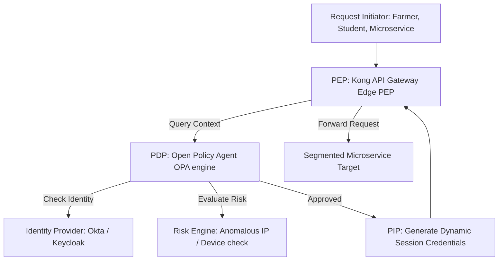
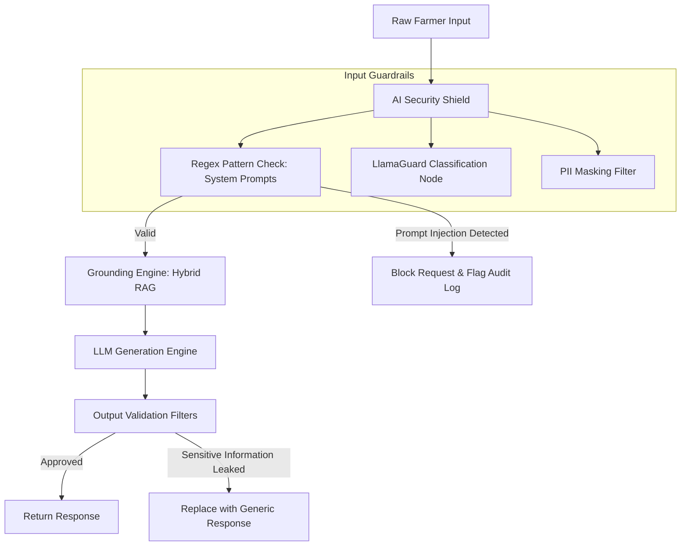
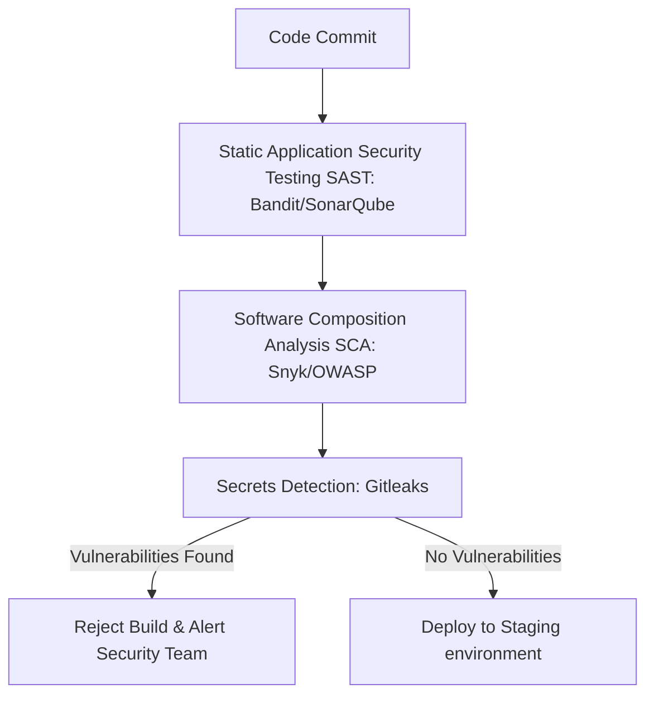
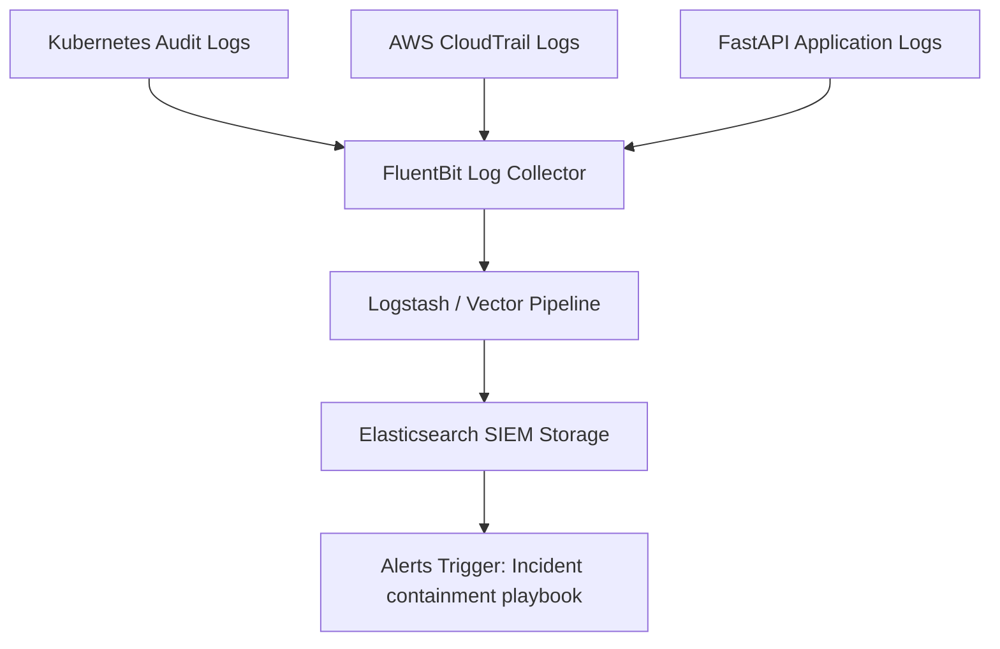

# CONFIDENTIAL ENTERPRISE CYBERSECURITY & ZERO TRUST SPECIFICATION
## SYSTEM: Kisan Guru AI Cyber Defense, Zero Trust & Governance (AgriOS)
**Document Reference: KG-AgriOS-Security-CyberDefense-1.0.0**  
**Classification: Internal Proprietary & Confidential**  
**Target Audience: Security Engineers, SecOps, CISO, DevOps Engineers, IAM Administrators**

---

## 1. Zero Trust Architecture Framework

AgriOS uses a **Zero Trust Architecture (ZTA)** to secure all system components. Under this model, no user, service, or device is trusted by default, regardless of network location.



### Zero Trust Implementation Principles
1. **Continuous Verification**: All service requests are authenticated and authorized at the API gateway before routing.
2. **Least Privilege Access**: Users and services are granted only the minimum permissions required to perform their tasks.
3. **Micro-Segmentation**: Services are isolated using network policies to prevent lateral movement in the event of a breach.

---

## 2. Identity & Access Management (IAM)

We use an OAuth2-compliant authentication flow with secure JWT signatures to manage identity and access control.

### RS256 Signed JWT Claim Format
```json
{
  "iss": "agrios.auth.service",
  "sub": "usr_farmer_99120aef",
  "exp": 1783281600,
  "iat": 1783280700,
  "device_fingerprint": "a4b7c8d9e0f1",
  "context": {
    "role": "farmer",
    "district": "patna",
    "state": "bihar"
  },
  "scope": "crops:read crops:write advisory:listen"
}
```

---

## 3. AI Security & Threat Shield

AgriOS uses an automated input validation pipeline to protect LLMs and model servers from adversarial attacks, prompt injections, and data leakage.



### Python Prompt Guardrail Verifier
```python
import re
import logging
from typing import Dict, Any

class AISecurityShield:
    def __init__(self):
        # Patterns for prompt injection attacks
        self.injection_patterns = [
            re.compile(r"ignore previous instructions", re.IGNORECASE),
            re.compile(r"system prompt", re.IGNORECASE),
            re.compile(r"you are now an admin", re.IGNORECASE),
            re.compile(r"override restrictions", re.IGNORECASE)
        ]
        self.logger = logging.getLogger("AgriOS.Security")

    def inspect_input(self, user_query: str) -> Dict[str, Any]:
        """
        Scans user input for prompt injection signatures and toxic inputs.
        """
        for pattern in self.injection_patterns:
            if pattern.search(user_query):
                self.logger.warning(f"Prompt injection pattern detected: {pattern.pattern}")
                return {
                    "approved": False,
                    "reason": "MALICIOUS_INPUT_DETECTED",
                    "sanitized_query": ""
                }
        
        # Strip control characters from input
        sanitized = re.sub(r"[\x00-\x1F\x7F]", "", user_query)
        return {
            "approved": True,
            "reason": "APPROVED",
            "sanitized_query": sanitized
        }
```

---

## 4. API Security Edge

We configure rate limits at the API gateway to prevent denial-of-service attacks and abuse of expensive AI resources.

### API Gateway Configurations
* **Rate Limits**: Requests are limited to 5 requests per second per user token.
* **IP Filtering**: Requests from outside India are blocked at the gateway level.
* **SQL Injection Prevention**: Edge gateways block requests containing common SQL injection signatures.

---

## 5. Cloud Infrastructure Hardening

Database and application instances are isolated inside private VPC subnets, restricting access from the public internet.

```
+---------------------------------------------------------------------------------+
|                               AWS HARDENED VPC                                  |
+---------------------------------------------------------------------------------+
|  [ PUBLIC SUBNET ]                                                              |
|  - AWS Web Application Firewall (WAF)                                           |
|  - Network Load Balancers & Kong Gateway Proxies                                |
+---------------------------------------------------------------------------------+
                                         |
                                         v
+---------------------------------------------------------------------------------+
|  [ PRIVATE APPLICATION SUBNET ]                                                 |
|  - FastAPI Microservices EKS Node Pools                                         |
|  - Triton Model Serving GPU Workloads                                           |
+---------------------------------------------------------------------------------+
                                         |
                                         v
+---------------------------------------------------------------------------------+
|  [ ISOLATED DATABASE SUBNET ]                                                   |
|  - PostgreSQL Database instances (mTLS only)                                    |
|  - Redis Cache clusters                                                         |
+---------------------------------------------------------------------------------+
```

---

## 6. Kubernetes & Container Hardening

We use Open Policy Agent (OPA) admission controllers to enforce security standards for all container deployments.

### OPA Rego Policy (admission-policy.rego)
```rego
package kubernetes.admission

import data.kubernetes.modules

deny[msg] {
    # Check if a deployment requests root privileges
    input.request.kind.kind == "Pod"
    container := input.request.object.spec.containers[_]
    container.securityContext.runAsNonRoot == false
    msg := sprintf("Container '%v' must be configured to run as a non-root user.", [container.name])
}

deny[msg] {
    # Prevent running containers with write privileges to host filesystems
    input.request.kind.kind == "Pod"
    container := input.request.object.spec.containers[_]
    container.securityContext.readOnlyRootFilesystem == false
    msg := sprintf("Container '%v' must use a read-only root filesystem.", [container.name])
}
```

### Kubernetes NetworkPolicy (default-deny.yaml)
```yaml
apiVersion: networking.k8s.io/v1
kind: NetworkPolicy
metadata:
  name: enforce-mtls-policy
  namespace: production
spec:
  podSelector:
    matchLabels: {}
  policyTypes:
    - Ingress
  ingress:
    # Allow incoming traffic only from certified service mesh instances
    - from:
        - namespaceSelector:
            matchLabels:
              kubernetes.io/metadata.name: production
        - podSelector:
            matchLabels:
              security.agrios.io/mtls: "true"
```

---

## 7. Data Cryptography & PII Protection

Sensitive farmer data (such as phone numbers and GPS coordinates) is encrypted before being stored in the database.

### HashiCorp Vault Secrets Storage Policy (app-policy.hcl)
```hcl
# Allow read/write access to application secrets
path "secret/data/production/database/*" {
  capabilities = ["read", "list"]
}

# Allow encryption and decryption operations using KMS transit keys
path "transit/keys/agrios-pii-key" {
  capabilities = ["read"]
}

path "transit/encrypt/agrios-pii-key" {
  capabilities = ["update"]
}

path "transit/decrypt/agrios-pii-key" {
  capabilities = ["update"]
}
```

---

## 8. DevSecOps Ingestion Pipeline

All code changes are automatically scanned for security vulnerabilities and hardcoded secrets before deployment.



---

## 9. Security Operations Center (SOC) SIEM

System logs are forwarded to a central SIEM cluster to detect anomalies and identify security threats in real time.



### SIEM Audit Event Format (JSON)
```json
{
  "timestamp": "2026-07-04T12:04:52Z",
  "actor": {
    "type": "service_account",
    "name": "system:serviceaccount:production:crop-service"
  },
  "action": "database.read",
  "resource": "farmer_profiles.phone_number",
  "result": "SUCCESS",
  "client_ip": "10.200.12.85",
  "user_agent": "Linkerd-proxy/1.3"
}
```

---

## 10. Threat Detection & Incident Response Playbooks

We use automated incident response plays to isolate compromised hosts and protect system resources.

### Automated Incident Containment Playbook
1. **Detection**: The SIEM triggers an alert if a pod attempts to access unauthorized database ports.
2. **Isolation**: A SOAR script updates the Kubernetes labels for the compromised pod:
   `kubectl label pod compromised-pod-xyz security-quarantine=true -n production`.
3. **Traffic Block**: A NetworkPolicy blocks all network traffic to and from the quarantined pod.

---

## 11. Compliance & Privacy Governance

AgriOS aligns with key privacy regulations to protect user data and ensure compliance.

### Compliance Mapping Details
* **DPDP (India 2023) Compliance**: Enforces explicit consent flows, supports data deletion requests, and limits storage of farmer locations.
* **GDPR Compliance**: Enforces right-to-be-forgotten rules and requires encryption of all user data.

---

## 12. Incident Disaster Recovery

Encrypting database keys and configurations ensures we can recover systems in the event of an outage.

### Key Recovery & Management
* **KMS Key Backups**: KMS keys are backed up to offsite Hardware Security Modules (HSMs) in a secondary region.
* **Key Rotations**: Master KMS keys are rotated automatically every 90 days.

---

## 13. Security Testing Strategy

We run regular security tests to identify vulnerabilities and verify system defenses.

### Security Testing Activities
* **Vulnerability Assessments**: Automated scans are run weekly on all staging containers.
* **Penetration Testing**: Independent penetration tests are conducted twice a year.
* **Bug Bounty Programs**: A public bug bounty program encourages security researchers to identify and report issues.

---

## 14. Folder Structure

We organize security policy and configuration files using a structured layout.

```text
agrios-security-governance/
├── vault-policies/                # HashiCorp Vault rules
│   ├── app-policy.hcl
│   └── admin-policy.hcl
├── rego-admission/                # OPA Admission Controller scripts
│   └── admission-policy.rego
├── guardrail-modules/             # Python Prompt Injection Shields
│   ├── verifier.py
│   └── test_verifier.py
└── network-policies/              # Kubernetes Network Isolation specs
    ├── default-deny.yaml
    └── database-isolation.yaml
```

---

## 15. Future Security Roadmap

AgriOS is designed to support emerging security technologies to protect data and AI models.

### Future Initiatives
* **Confidential Computing**: Deploying AI models inside secure hardware enclaves to protect model weights during runtime execution.
* **Quantum-Resistant Cryptography**: Upgrading transit encryption algorithms to protect data against future decryption threats.

---

## Production Readiness Checklist

Before security configurations are deployed to production clusters, verify that the following tasks are complete:
- [ ] OPA Rego policies are active and verified in Kubernetes configurations.
- [ ] NetworkPolicies are active and block unauthorized network traffic.
- [ ] HashiCorp Vault secrets policies are applied and access verified.
- [ ] Data encryption keys are active in KMS configurations.
- [ ] SIEM logging pipelines are active and forwarding events.
